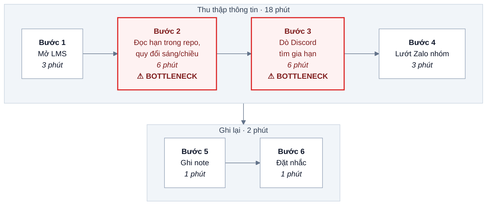
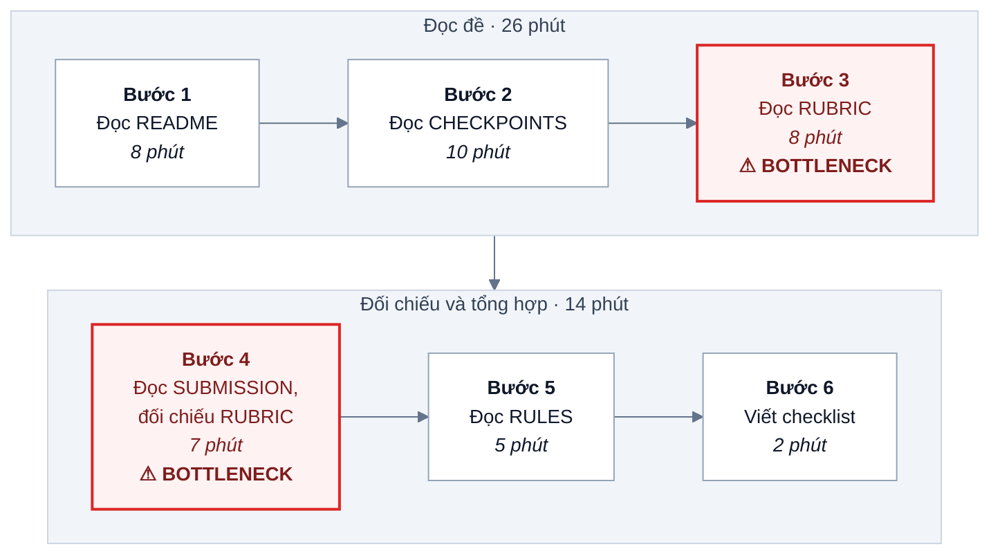
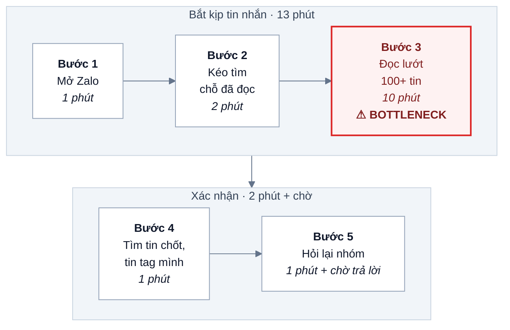

# Báo cáo cá nhân — 2A202603447_NguyenHoang

> Đổi tên file theo quy tắc `MSSV_HoTen.md`, ví dụ `20241234_NguyenVanAn.md` (MSSV trước, dấu `_`, họ tên viết liền không dấu). Sửa cả dòng tiêu đề phía trên cho khớp.
> Template chi tiết và prompt mẫu cho từng mục: [docs/01-worksheet.md](../../docs/01-worksheet.md).
> Mỗi thành viên một file trong `report/individual/` trên repo nhóm: copy template này thành file mới, điền, rồi commit bằng tài khoản GitHub của bạn. Không viết hộ người khác.

> **Ghi chú (bài luyện tập):** các con số thời gian, tần suất và số người trong báo cáo này là ước tính minh họa, chưa bấm giờ hay đếm thật. Thay bằng số đo thật trước khi dùng cho bài chấm điểm.

## 1. Thông tin học viên

- Họ tên: Nguyễn Hoàng
- MSSV: 2A202603447
- Email trường (không bắt buộc, repo có thể để public):
- Tên nhóm: BunRieuTopMo
- Link repo nhóm: https://github.com/TgTrh06/K5-L3A-DAY02-BunRieuTopMo-DiscoveryProblemFraming.git

---

## 2. Scan problem (CP1)

Lăng kính: **Lặp lại** · **Tốn thời gian** · **Cần đọc, tổng hợp nhiều thông tin** · **Pain từ người khác**.

Bối cảnh: tôi là học viên AI20k K5 (lớp L3A), học song song với đi làm. Mỗi tuần có 2–3 buổi lab, làm nhóm 3–4 người, thông tin đến từ LMS, Discord lớp và nhóm Zalo.

| # | Lăng kính | Job Story: Khi… tôi muốn… để… | Ai chịu ảnh hưởng? | Dấu hiệu thật (thời gian, tần suất, số người, bằng chứng) |
|---:|---|---|---|---|
| 1 | Lặp lại | Khi đầu tuần có lab mới, tôi muốn biết hết deadline và mốc nộp của tuần ở một chỗ, để không lỡ hạn nào | Tôi, cả lớp | ~20 phút/tuần lục LMS + Discord + Zalo; 2 lần trong tháng trước suýt trễ vì nhầm lab sáng/chiều (hạn khác nhau 12 tiếng) |
| 2 | Tốn thời gian | Khi ôn lại một khái niệm coach đã giảng, tôi muốn tìm đúng đoạn trong video buổi học, để không phải xem lại cả buổi | Tôi, học viên vắng buổi | Video 3–4 tiếng/buổi; mỗi lần tua tìm mất 15–25 phút, khoảng 3 lần/tuần |
| 3 | Cần đọc, tổng hợp nhiều thông tin | Khi nhận đề lab mới, tôi muốn nắm nhanh phải làm gì và nộp gì, để bắt tay làm ngay trong giờ lab | Tôi, cả lớp | Đề Day 02 gồm 6 file chính (~1.000 dòng); tôi mất ~40 phút đọc, thông tin nộp bài nằm rải ở README, SUBMISSION, RUBRIC, RULES |
| 4 | Pain từ người khác | Khi sắp tới hạn nộp, các bạn trong lớp muốn chắc chắn đặt tên repo/file đúng quy định, để không bị trừ 5 điểm | Học viên, coach | Kênh Discord lớp có ~10 câu hỏi lặp lại kiểu "đặt tên file thế nào", "nộp link nào" mỗi lab |
| 5 | Lặp lại | Khi nhóm ăn chung sau buổi học, tôi muốn biết ai đã trả và ai còn nợ bao nhiêu, để không phải nhắn đòi lắt nhắt | Nhóm 4 người | ~2 lần/tuần, mỗi lần ~15 phút cộng trừ trên Zalo; 1 lần tính nhầm phải chuyển khoản lại |
| 6 | Tốn thời gian | Khi bắt đầu một lab có code, tôi muốn môi trường Python chạy được ngay, để dùng giờ lab cho bài chính | Tôi, nhiều bạn dùng Windows | 30–60 phút/lần sửa lỗi version thư viện; ~1 lần/tuần |
| 7 | Pain từ người khác | Khi cả nhóm cùng sửa một file trên repo chung, chúng tôi muốn không bị ghi đè bài của nhau, để không mất phần đã viết | Nhóm 3–4 người | Lab trước bị conflict 2 lần, mỗi lần ~20 phút gỡ; 1 bạn mất một đoạn đã viết |
| 8 | Cần đọc, tổng hợp nhiều thông tin | Khi quay lại nhóm Zalo sau vài tiếng bận việc, tôi muốn biết nhóm đã chốt gì và giao ai làm gì, để không hỏi lại | Tôi, thành viên đi làm | 100–200 tin/ngày lúc chạy deadline; ~15 phút đọc lại mỗi lần, ~4 lần/tuần |
| 9 | Lặp lại | Khi cuối ngày ở chỗ làm, tôi muốn ghi nhanh việc đã làm hôm nay, để báo cáo tuần không phải nhớ lại | Tôi, trưởng nhóm ở công ty | ~10 phút/ngày; thứ Sáu viết báo cáo tuần thêm ~30 phút vì quên ghi |
| 10 | Tốn thời gian | Khi hoàn thiện báo cáo Markdown, tôi muốn ảnh và sơ đồ hiển thị đúng trên GitHub, để coach đọc được | Tôi, cả lớp | ~20 phút/báo cáo sửa đường dẫn ảnh, lỗi cú pháp Mermaid |

**Nếu có dùng AI để gợi ý thêm:** ý nào AI gợi ý mà bạn giữ lại, ý nào bỏ và vì sao.

- Tôi tự scan 8 ý đầu, sau đó hỏi AI theo prompt CP1 trong worksheet.
- **Giữ lại** #9 (log việc hằng ngày) và #10 (ảnh/Mermaid lỗi hiển thị). Đây là ý từ AI, nhưng tôi viết lại theo trải nghiệm của mình và ghi số phút của chính mình.
- **Bỏ** "trợ lý AI học tập cá nhân hóa toàn khóa": quá rộng, không có quy trình cụ thể, và là solution chứ không phải problem.
- **Bỏ** "dịch tài liệu tiếng Anh": tôi đọc tiếng Anh được, không có dấu hiệu là pain thật của tôi.

---

## 3. Top 3 Problem Cards + quy trình nháp (CP2)

### Bảng chọn top 3

| Rank | Problem | Vì sao chọn | Điều còn chưa chắc |
|---:|---|---|---|
| 1 | Gom deadline và mốc nộp từ nhiều kênh (#1, gộp với #4) | Lặp lại mỗi tuần, actor rõ (học viên), quy trình vẽ được, có hậu quả đo được (suýt trễ, câu hỏi lặp lại) | Các bạn khác có thật sự mất thời gian như tôi không, hay chỉ mình tôi bị rối? |
| 2 | Đọc đề lab dài để biết phải làm và nộp gì (#3) | Mỗi lab đều gặp, mất ~40 phút, cả lớp cùng gặp | Đọc kỹ đề có phải là một phần của việc học không, nên rút ngắn đến đâu? |
| 3 | Tìm lại nhóm đã chốt gì trong chat Zalo (#8) | Thời gian cộng dồn lớn (~1 tiếng/tuần), gây hỏi lại và giao việc trùng | Dữ liệu chat riêng tư, khó đưa vào công cụ; phạm vi dễ phình to |

### Problem Card #1

| Trường | Nội dung |
|---|---|
| Job Story | Khi đầu tuần có lab mới, tôi muốn biết hết deadline và mốc nộp của tuần ở một chỗ, để không lỡ hạn nào |
| Actor | Học viên AI20k vừa học vừa làm, theo 2–3 lab/tuần |
| Thời điểm / bối cảnh | Tối Chủ nhật hoặc sáng thứ Hai, và mỗi khi coach đăng thông báo gia hạn trên LMS |
| Quy trình hiện tại (3–7 bước) | 1. Mở LMS xem bài nộp của tuần · 2. Mở README/SUBMISSION của từng repo lab để xem hạn (sáng: 23h59 cùng ngày, chiều/tối: 11h59 hôm sau) · 3. Lướt Discord lớp tìm thông báo gia hạn · 4. Lướt Zalo nhóm xem nhóm tự đặt mốc nội bộ · 5. Ghi tay vào note điện thoại · 6. Tự đặt nhắc |
| Bottleneck (bước nào, mất bao nhiêu phút) | Bước 2–3: quy đổi hạn theo buổi sáng/chiều và dò thông báo gia hạn, ~12 phút/tuần, hay nhầm |
| Impact (nếu không giải thì sao) | ~20 phút/tuần/người; 2 lần suýt trễ trong 1 tháng; commit sau deadline không được chấm (không có nộp muộn trừ điểm) nên trễ là mất trắng |
| Success metric (baseline → target) | Thời gian gom deadline: 20 → dưới 5 phút/tuần; số lần suýt trễ/nhầm hạn: 2/tháng → 0 |
| Phương án không dùng AI | Một Google Calendar chung của lớp hoặc nhóm, một người cập nhật khi có lab mới; quy tắc cố định "lab sáng = 23h59 cùng ngày, lab chiều = 11h59 hôm sau" |
| Giả thuyết về AI (nếu có) | AI đọc thông báo LMS/Discord và trích ra mốc hạn mới. Nhưng thông báo khá ngắn và ít, chưa chắc cần |
| Cảm nhận nhanh | Rule |

**Quy trình nháp hiện tại** — tổng ~20 phút/tuần · ô đỏ là bottleneck

### Problem Card #2

| Trường | Nội dung |
|---|---|
| Job Story | Khi nhận đề lab mới, tôi muốn nắm nhanh phải làm gì và nộp gì, để bắt tay làm ngay trong giờ lab |
| Actor | Học viên AI20k ở đầu buổi lab |
| Thời điểm / bối cảnh | 15–30 phút đầu buổi lab, khi vừa fork repo đề |
| Quy trình hiện tại (3–7 bước) | 1. Đọc README · 2. Mở CHECKPOINTS · 3. Mở RUBRIC xem chấm gì · 4. Mở SUBMISSION xem tên repo/file · 5. Đọc RULES phần dùng AI · 6. Tự ghi checklist ra giấy |
| Bottleneck (bước nào, mất bao nhiêu phút) | Bước 3–4: đối chiếu RUBRIC với SUBMISSION để biết lỗi nào bị trừ nặng (sai tên file −5, thiếu TEAM.md = 0 phần nhóm), ~15 phút |
| Impact (nếu không giải thì sao) | ~40 phút/lab, 2 lab/tuần ≈ 80 phút/tuần; dễ sót quy định "xóa template sau khi mọi người copy" |
| Success metric (baseline → target) | Thời gian từ lúc mở repo đến lúc có checklist nộp bài: 40 → 15 phút; số lỗi định dạng khi nộp: 1/lab → 0 |
| Phương án không dùng AI | Coach hoặc lớp dùng một checklist nộp bài cố định cho mọi lab; tự viết checklist cá nhân một lần rồi tái dùng |
| Giả thuyết về AI (nếu có) | AI tóm tắt đề thành checklist "làm gì, nộp gì, bị trừ gì" có trích dẫn file nguồn; học viên tự đối chiếu |
| Cảm nhận nhanh | Workflow |

**Quy trình nháp hiện tại** — tổng ~40 phút/lab · ô đỏ là bottleneck

### Problem Card #3

| Trường | Nội dung |
|---|---|
| Job Story | Khi quay lại nhóm Zalo sau vài tiếng bận việc, tôi muốn biết nhóm đã chốt gì và giao ai làm gì, để không hỏi lại |
| Actor | Thành viên nhóm lab vừa học vừa đi làm |
| Thời điểm / bối cảnh | Giờ nghỉ trưa hoặc tối, trong 1–2 ngày trước deadline |
| Quy trình hiện tại (3–7 bước) | 1. Mở Zalo thấy 100+ tin chưa đọc · 2. Kéo lên tin cuối mình đã đọc · 3. Đọc lướt toàn bộ · 4. Tìm tin có chữ "chốt", "ok", tag tên mình · 5. Hỏi lại nhóm nếu vẫn không rõ |
| Bottleneck (bước nào, mất bao nhiêu phút) | Bước 3: đọc lướt để tách quyết định khỏi tin tán gẫu, ~10 phút/lần |
| Impact (nếu không giải thì sao) | ~15 phút × 4 lần/tuần = 60 phút/tuần; lab trước có 1 phần bị 2 người cùng làm vì không thấy tin phân công |
| Success metric (baseline → target) | Thời gian bắt kịp nhóm: 15 → dưới 3 phút/lần; số việc làm trùng: 1/lab → 0 |
| Phương án không dùng AI | Ghim một tin "Quyết định + phân công" và cập nhật mỗi khi chốt; hoặc dùng bảng phân công trong `TEAM.md` |
| Giả thuyết về AI (nếu có) | Tóm tắt đoạn chat chưa đọc thành danh sách quyết định + người phụ trách |
| Cảm nhận nhanh | No AI |

**Quy trình nháp hiện tại** — tổng ~15 phút/lần · ô đỏ là bottleneck

### Card muốn pitch nhất

- Card số: 1
- Vì sao: lặp lại đều mỗi tuần, hậu quả nặng (trễ là không được chấm), có dấu hiệu từ người khác (câu hỏi lặp lại trên Discord), và so sánh rõ được giữa No AI / Rule / Workflow.
- Câu hỏi muốn nhóm phản biện: "Nếu chỉ cần một Google Calendar chung là đủ, thì bài này có còn đáng chọn để phân tích sâu không, hay quá dễ?"

### AI đã phản biện card thế nào

Đưa card #1 cho AI đóng vai "PM hoài nghi" theo prompt CP2 trong worksheet.

| Điểm yếu AI chỉ ra | Đồng ý? | Đã sửa gì |
|---|---|---|
| Baseline "20 phút/tuần" dựa trên trí nhớ, chưa đo | Đồng ý | Ghi rõ là ước tính; kế hoạch bấm giờ 2 tuần tới và đưa vào giả định cần kiểm chứng ở CP4 |
| Ban đầu tôi ghi bottleneck là "thông tin rải rác", quá mơ hồ | Đồng ý | Sửa thành bước cụ thể: bước 2–3, quy đổi hạn sáng/chiều và dò thông báo gia hạn, ~12 phút |
| Metric "không trễ hạn" khó thấy vì trễ vốn hiếm | Đồng ý một phần | Thêm metric "số lần suýt trễ/nhầm hạn mỗi tháng" để đo sớm hơn |
| Gợi ý làm bot Discord tự quét thông báo và nhắc | Không đồng ý | Chưa có bằng chứng Rule + lịch chung không đủ; giữ cảm nhận nhanh là Rule |

---

## 4. Tôi đã tham gia phần nào (CP3 → CP7)

Nhóm chọn candidate từ card #1 của tôi (gom deadline, gộp với câu hỏi lặp lại về nộp bài của bạn khác) để phân tích ở phần nhóm.

| Hoạt động | Tôi đã làm gì? | Kết quả / ảnh hưởng tới bài nhóm |
|---|---|---|
| Pitch Problem Card | Pitch 3 card, mỗi card ~1,5 phút, tập trung card #1 | Card #1 vào shortlist 3 candidate |
| Phản biện bài của bạn khác | Câu hỏi tôi đã đặt: "Lần gần nhất bạn gặp chuyện này là khi nào và mất bao lâu?" và "Nếu không có AI, cách đơn giản nhất để giảm một nửa thời gian là gì?" cho một card về tóm tắt video bài giảng | Bạn đó nhận ra coach đã đăng slide kèm timestamp, pain nhỏ hơn dự kiến; card bị loại khỏi shortlist |
| Nhận phản biện | Câu hỏi tôi nhận được: "Bạn có bằng chứng người khác cũng nhầm hạn không, hay chỉ mình bạn?" | Tôi đã sửa gì: gộp card #1 với pain #4 (câu hỏi lặp lại trên Discord) để có dấu hiệu từ người khác; đưa "học viên khác cũng mất >10 phút/tuần" thành giả định số 1 cần kiểm chứng |
| Gom cluster / cây OST | Đề xuất gom "gom deadline", "hỏi lại cách nộp bài", "đọc đề lab dài" thành một cluster "nắm yêu cầu và mốc nộp của lab" | Thành cluster lớn nhất; giúp nhóm viết outcome chung |
| Chọn candidate problem | Chấm điểm 7 tiêu chí; tranh luận giữ card #1 thay vì card "đọc đề lab" | Nhóm chọn card #1 vì baseline đo được ngay và phạm vi vừa sức |
| Kiểm chứng / research | Soạn câu hỏi phỏng vấn theo The Mom Test; research cách xuất lịch từ LMS và nhập vào Google Calendar | Phát hiện lịch có thể nhập bằng file iCal, ủng hộ hướng Rule |
| Quy trình nhóm | Vẽ quy trình hiện tại dạng ASCII, ghi số phút từng bước | Dùng làm bản gốc cho mục 4 báo cáo nhóm |
| Problem Statement | Đề xuất tách metric "suýt trễ" khỏi "trễ thật" | Nhóm giữ cả hai metric trong v0 |
| Mức can thiệp AI | Lập luận vì sao Rule đủ: hạn có đúng/sai rõ, ít nguồn, thông báo gia hạn hiếm | Nhóm chọn Rule, không dùng AI cho bước chính |
| Quyết định | Đề xuất ngưỡng dừng: sau 3 tuần vẫn có người nhầm hạn thì thêm bước nhắc tự động | Đưa vào mục 8 báo cáo nhóm |

---

## 5. Dùng AI

| Checkpoint | Tôi dùng AI để làm gì? | AI hữu ích ở đâu? | AI sai hoặc hời hợt ở đâu? | Tôi sửa gì bằng nhận định của mình? |
|---|---|---|---|---|
| CP1 Scan | Gợi ý thêm problem sau khi tự scan 8 ý | Nhắc tôi các việc lặp lại ngoài lớp học (log việc ở công ty) | Đưa ý quá rộng "trợ lý học tập toàn năng", và nhiều ý viết sẵn giải pháp | Bỏ ý quá rộng; viết lại 2 ý giữ lại thành Job Story với số phút của tôi |
| CP2 Problem Card | Đóng vai PM hoài nghi phản biện card #1 | Chỉ ra baseline dựa trên trí nhớ và bottleneck mơ hồ | Gợi ý ngay một bot Discord, nhảy sang giải pháp quá sớm | Sửa bottleneck thành bước cụ thể; giữ cảm nhận Rule |
| CP4 Research | Tìm cách đưa lịch LMS vào Google Calendar | Gợi ý đúng hướng iCal/export lịch | Đưa một link hướng dẫn không mở được và mô tả tính năng không có trên LMS của lớp | Tự mở từng link, chỉ giữ link kiểm được; bỏ claim không kiểm được |
| CP5 Quy trình | Chuyển mô tả quy trình sang sơ đồ | Tiết kiệm thời gian vẽ | Gộp bước "đọc hạn" và "quy đổi sáng/chiều" làm một, làm mất bottleneck | Tách lại thành 2 bước, ghi số phút riêng |
| CP5–6 Problem Statement | Hỏi lỗ hổng của Problem Statement v0 | Chỉ ra metric chưa ghi cách đo | Muốn viết lại cả bản theo giọng văn của nó | Chỉ lấy câu hỏi, tự sửa trường Success Metric |
| CP6 Mức can thiệp / quyết định | Hỏi phản biện lựa chọn Rule | Đặt câu hỏi "ai cập nhật lịch khi có gia hạn" | Cho rằng nên dùng Workflow có AI vì "thông báo là văn bản tự do" | Đếm lại: chỉ 1–2 thông báo gia hạn/tháng, người đọc mất 1 phút; giữ Rule |

---

## 6. Reflection (CP7)

Trả lời bằng trải nghiệm thật của bạn, tối thiểu 200 từ cho các câu 6.1–6.6 (không tính 6.7, câu này được chấm riêng ở tiêu chí C5). **Không dùng AI để viết thay.**

**6.1. Tôi học được gì khi nghe top 3 problems của các bạn khác?**

Nghe các bạn pitch, tôi nhận ra nhiều problem nhìn khác nhau nhưng thật ra cùng một gốc: thông tin của lớp nằm rải ở quá nhiều kênh (LMS, Discord, Zalo, repo). Bạn thì than đọc đề lâu, bạn thì hỏi lại cách nộp, tôi thì nhầm hạn, nhưng đều là "không biết chính xác phải làm gì và trước lúc nào". Tôi cũng thấy card của người khác dễ bị nói quá: khi được hỏi "lần gần nhất là khi nào", có card chỉ còn lại một lần duy nhất từ mấy tuần trước.

**6.2. Nhóm có lúc nào bị "solution-first" (nghĩ giải pháp trước khi hiểu vấn đề) không? Lúc đó nhóm nhận ra và xử lý thế nào?**

Có. Ngay sau khi chọn candidate, cả nhóm bàn luôn về việc làm một bot Discord đọc thông báo và nhắc deadline, trong khi chưa ai đo xem mình thật sự mất bao nhiêu phút. Lúc vẽ cây OST, một bạn viết "bot nhắc deadline" vào tầng opportunity, và nhóm phải gạch đi vì đó là solution. Sau đó nhóm quay lại hỏi: pain là ở bước nào, và một lịch chung có giải được không.

**6.3. Tôi có đổi ý sau khi bị phản biện không? Kể một lần cụ thể.**

Có. Ban đầu tôi tin card #1 là pain của cả lớp. Khi bị hỏi "bạn có bằng chứng người khác cũng nhầm hạn không", tôi không trả lời được, vì dấu hiệu chỉ có từ bản thân tôi. Tôi đổi cách nhìn: gộp nó với các câu hỏi lặp lại trên Discord để có dấu hiệu từ người khác, và chấp nhận đây là giả định cần kiểm chứng chứ không phải sự thật.

**6.4. Kết quả kiểm chứng (phỏng vấn/survey/research) có làm tôi bất ngờ không? Điều gì?**

Bất ngờ nhất là có người không gặp vấn đề này chút nào, vì họ chỉ theo đúng một kênh là LMS và đã tự đặt nhắc ngay khi lab mở. Điều đó cho tôi thấy pain nằm ở việc phải dò thông báo gia hạn và quy đổi giờ, chứ không phải ở việc "có quá nhiều deadline".

**6.5. Điều khó nhất khi viết Problem Statement là gì?**

Khó nhất là Success Metric. Viết "không trễ hạn" thì dễ, nhưng trễ hạn vốn hiếm nên đo vài tuần sẽ không thấy khác biệt. Phải tìm một chỉ số xảy ra thường hơn, như số lần suýt trễ hoặc số câu hỏi lặp lại, và phải nói rõ ai đếm, đếm ở đâu.

**6.6. Nếu làm lại, tôi sẽ đổi gì? Tôi sẽ phản biện nhóm mạnh hơn ở điểm nào?**

Tôi sẽ bấm giờ thật ít nhất một tuần trước buổi lab thay vì ước lượng, vì gần như mọi phản biện đều quay về câu "số này ở đâu ra". Tôi cũng sẽ phản biện mạnh hơn ở bước chọn candidate: bài của nhóm hơi dễ và kết luận Rule gần như thấy trước, có thể nhóm nên chọn card "đọc đề lab" để thực hành phân tích một bước có AI rõ hơn.

**6.7. Hiểu bài:** giải thích bằng 5–8 câu, không nhìn tài liệu, chuỗi *problem → quy trình → metric → boundary → mức can thiệp AI → quyết định* của bài nhóm mình.

Problem: học viên vừa học vừa làm mất khoảng 20 phút mỗi tuần để gom deadline từ LMS, repo đề, Discord và Zalo, và vẫn có lúc suýt trễ vì nhầm hạn lab sáng/chiều hoặc bỏ sót thông báo gia hạn. Quy trình hiện tại có 6 bước thủ công; bottleneck là bước đọc hạn trong từng repo kèm quy đổi sáng/chiều và bước dò thông báo gia hạn trên Discord. Metric: thời gian gom deadline giảm từ 20 xuống dưới 5 phút/tuần, số lần suýt trễ từ 2/tháng về 0, đo bằng tự bấm giờ và tự ghi trong 3 tuần pilot. Boundary: lịch chung chỉ là tham chiếu, nguồn chuẩn vẫn là LMS và thông báo của coach; không ai được tự đổi hạn trên lịch nếu chưa có thông báo chính thức. Mức can thiệp là Rule: một Google Calendar chung, quy tắc cố định "sáng 23h59, chiều 11h59 hôm sau", một người cập nhật khi có lab mới hoặc gia hạn; không cần AI vì hạn có đúng/sai rõ, nguồn ít và thông báo gia hạn hiếm. Quyết định là Go với phạm vi nhỏ: chạy thử 3 tuần trong nhóm; nếu sau 3 tuần vẫn có người nhầm hạn hoặc người cập nhật bỏ sót gia hạn quá 1 lần thì thêm bước nhắc tự động, và chỉ cân nhắc AI trích hạn từ thông báo khi số thông báo tăng đáng kể.

---

## 7. Tài liệu tham khảo

- Design Council — The Double Diamond: https://www.designcouncil.org.uk/our-resources/the-double-diamond/
- Anthropic — Building effective agents: https://www.anthropic.com/research/building-effective-agents
- Google Calendar Help — Import events to Google Calendar: https://support.google.com/calendar/answer/37118
- Moodle Docs — Calendar (xuất lịch iCal): https://docs.moodle.org/en/Calendar
- Đề lab: [README.md](../../README.md), [CHECKPOINTS.md](../../CHECKPOINTS.md), [docs/01-worksheet.md](../../docs/01-worksheet.md)
