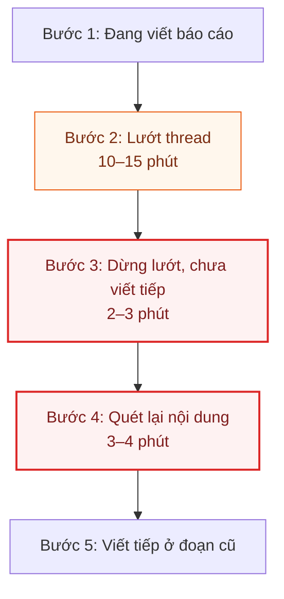
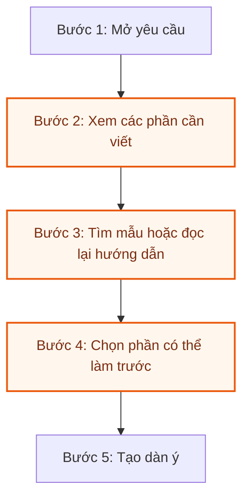
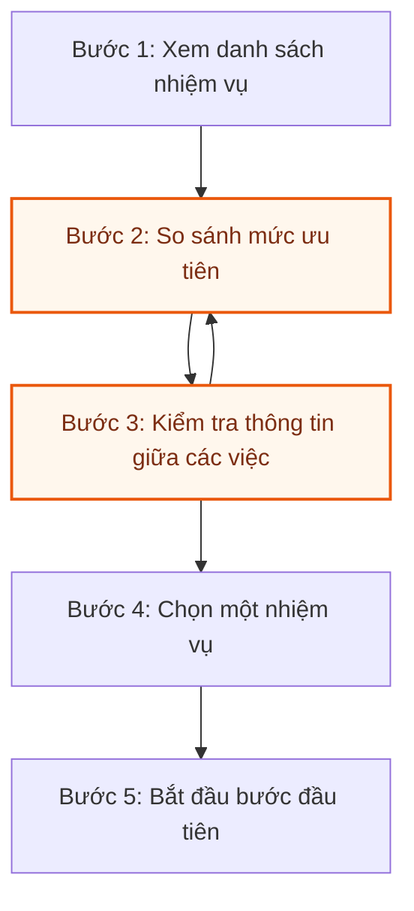

# Báo cáo cá nhân — 2A202603456_TrinhThanhTung

## 1. Thông tin học viên

- Họ tên: TRỊNH THANH TÙNG
- MSSV: 2A202603456
- Tên nhóm: BunRieuTopMo
- Link repo nhóm: https://github.com/TgTrh06/K5-L3A-DAY02-BunRieuTopMo-DiscoveryProblemFraming.git

**Phạm vi:** Bài tập trung vào việc bắt đầu và duy trì mạch làm việc khi viết báo cáo. Nguồn tình huống là lời kể đã ghi ở CP1; các hướng mở rộng được trình bày dưới dạng vấn đề cần khảo sát. Số phút từ lời kể là ước tính, còn các ngưỡng mục tiêu dùng để thiết kế phép thử. Phần CP3–CP7 thể hiện phân tích và hướng đóng góp cá nhân để trao đổi với nhóm.

---

## 2. Scan problem (CP1)

Lăng kính: **Lặp lại** · **Tốn thời gian** · **Cần đọc, tổng hợp nhiều thông tin** · **Pain từ người khác**.

**Tình huống xuất phát:** Một người bạn đang viết báo cáo nộp sếp thì mất tập trung, lướt thread 10–15 phút, ngồi ngẩn ngơ 2–3 phút, rồi quét lại nội dung 3–4 phút trước khi viết tiếp ở đoạn cũ. Tổng thời gian gián đoạn ước tính 15–22 phút theo lời kể, chưa bấm giờ. Người bạn cũng kể có việc được biết trước khoảng một tuần nhưng vẫn bắt đầu sát giờ.

Từ tình huống này, có thể mở rộng việc tìm hiểu theo ba thời điểm: trước khi bắt đầu, trong lúc thực hiện và khi quay lại sau gián đoạn. Bảng dưới đây tách các nhu cầu thành Job Story và xác định dấu hiệu cần quan sát cho từng hướng.

| # | Lăng kính | Job Story: Khi… tôi muốn… để… | Ai chịu ảnh hưởng? | Dấu hiệu cần quan sát / cách đo |
|---:|---|---|---|---|
| 1 | Lặp lại; trì hoãn bắt đầu | Khi biết hạn báo cáo từ trước, tôi muốn bắt đầu sớm từng phần để không phải dồn việc sát hạn | bạn An; người chờ nhận báo cáo | Khoảng cách từ lúc nhận việc đến lúc tạo nội dung đầu tiên; tỷ lệ báo cáo bắt đầu trong ngày cuối trước hạn |
| 2 | Tốn thời gian; xao nhãng | Khi quay lại báo cáo sau khi lướt thread, tôi muốn nhớ đúng chỗ đang viết để tiếp tục mạch công việc | bạn An | Tình huống xuất phát có 10–15 phút lướt và 5–7 phút khôi phục; ghi riêng hai khoảng thời gian khi quan sát |
| 3 | Cần đọc, tổng hợp nhiều thông tin | Khi nhận nhiệm vụ có yêu cầu dài, tôi muốn xác định việc cần làm trước để bắt đầu thay vì đọc lại hướng dẫn nhiều lần | bạn An; người giao nhiệm vụ | Thời gian từ lúc mở yêu cầu đến khi xác định được đầu ra và bước đầu tiên; số lần phải hỏi lại |
| 4 | Tốn thời gian; việc lớn khó bắt đầu | Khi có báo cáo phân tích nhiều phần, tôi muốn xác định một bước đầu đủ nhỏ để bắt tay vào làm | bạn An; người nhận báo cáo | Thời gian từ lúc mở tài liệu đến khi có dàn ý; lý do rời tài liệu trước khi tạo nội dung |
| 5 | Pain từ người khác; lo bản nháp chưa tốt | Khi viết phần mở đầu để quản lý đọc, tôi muốn có bản nháp sớm để còn thời gian hoàn thiện | bạn An; quản lý đọc báo cáo | Số lần sửa tiêu đề hoặc dàn ý trước đoạn văn đầu tiên; lý do chọn sửa thay vì viết tiếp |
| 6 | Lặp lại; khoảng thời gian ngắn | Khi có khoảng trống giữa hai lịch, tôi muốn hoàn thành một bước nhỏ của báo cáo để duy trì tiến độ | bạn An | Số khoảng trống có thể dùng; số bước nhỏ thực sự hoàn thành; thời gian chuẩn bị để bắt đầu |
| 7 | Lặp lại; chờ có hứng | Khi đến giờ đã định làm nhưng chưa cảm thấy sẵn sàng, tôi muốn bắt đầu bằng một hành động cụ thể để không tiếp tục dời việc | bạn An | Chênh lệch giữa giờ dự định và giờ bắt đầu; hoạt động thay thế trong khoảng chờ |
| 8 | Pain từ người khác; phụ thuộc đầu vào | Khi báo cáo cần số liệu từ đồng đội, tôi muốn làm phần độc lập trước để vẫn tiến triển trong lúc chờ | bạn An; đồng đội cung cấp số liệu | Thời gian chờ đầu vào; những phần có thể thực hiện độc lập; phần việc đã hoàn thành trong lúc chờ |
| 9 | Cần đọc, tổng hợp nhiều thông tin; khó chọn ưu tiên | Khi có nhiều nhiệm vụ cùng hạn, tôi muốn chọn việc cần làm trước để không liên tục chuyển qua lại | bạn An; cộng sự phụ thuộc đầu ra | Thời gian chọn việc; số lần chuyển nhiệm vụ; lý do chuyển và quyền quyết định thứ tự |
| 10 | Tốn thời gian; thông báo gây gián đoạn | Khi chuẩn bị bắt đầu một phần báo cáo, tôi muốn tập trung đủ lâu để hoàn tất bước đầu | bạn An; người nhận báo cáo | Số thông báo dẫn đến chuyển ứng dụng; thời gian từ lúc bắt đầu đến khi hoàn tất bước đầu tiên |

**Chọn lọc sau khi dùng AI hỗ trợ phân tích:**

- Giữ #2, #4 và #9 để phát triển Problem Card vì mỗi hướng có một thời điểm, một nhu cầu và một phép đo riêng.
- Để #1 và #7 ở vòng khảo sát vì “bắt đầu muộn” có thể do nhiều nguyên nhân; cần phân biệt thiếu đầu vào, khó xác định bước đầu và chủ động đổi ưu tiên.
- Xem #10 như một tác nhân có thể liên quan đến #2; tránh đếm cùng một lần gián đoạn thành hai pain độc lập.
- Loại hướng “trợ lý AI quản lý toàn bộ công việc” khỏi phạm vi vì đó là giải pháp rộng, chưa xác định bước cụ thể cần cải thiện.

---

## 3. Top 3 Problem Cards + quy trình nháp (CP2)

### Bảng chọn top 3

| Rank | Problem | Vì sao chọn | Câu hỏi cần kiểm chứng |
|---:|---|---|---|
| 1 | Khó quay lại mạch viết sau khi lướt thread (#2) | Có tình huống xuất phát cụ thể; tách được thời gian lướt và thời gian khôi phục; có cách thử thủ công | Tình huống xảy ra thường xuyên đến đâu, và phần khôi phục có gây ảnh hưởng đáng kể không? |
| 2 | Khó bắt đầu báo cáo nhiều phần (#4) | Đầu ra bước đầu có thể xác định rõ; dễ quan sát thời gian đến khi có dàn ý | Người viết bị kẹt vì yêu cầu mơ hồ, thiếu dữ liệu hay chưa chọn được bước đầu? |
| 3 | Khó chọn ưu tiên giữa nhiều nhiệm vụ (#9) | Có điểm quyết định cụ thể; so sánh được cách chọn tự phát với tiêu chí thống nhất | Người thực hiện có quyền chọn thứ tự không, và việc chuyển nhiệm vụ có bắt buộc không? |

### Problem Card #1

| Trường | Nội dung |
|---|---|
| Job Story | Khi quay lại báo cáo sau khi lướt thread trên điện thoại, tôi muốn nhớ đúng ý và bước tiếp theo, để tiếp tục viết mà không phải dò lại lâu |
| Actor | bạn An — viết báo cáo nộp quản lý trong tình huống ở CP1 |
| Thời điểm / bối cảnh | Trong phiên viết, ngay sau khi dừng xem thread và quay lại tài liệu |
| Quy trình hiện tại (3–7 bước) | 1. Đang viết báo cáo · 2. Chuyển sang lướt thread · 3. Dừng lướt nhưng chưa viết tiếp · 4. Quét lại nội dung · 5. Viết tiếp ở đoạn cũ |
| Bottleneck | Bước 3–4 là phạm vi cần cải thiện: khoảng 5–7 phút để lấy lại mạch viết. Bước 2 mất 10–15 phút và được theo dõi riêng |
| Impact | Một lần gián đoạn trong lời kể kéo dài khoảng 15–22 phút; phần khôi phục làm tăng thời gian trước khi có thể tiếp tục công việc |
| Success metric (baseline → target) | Khoảng khôi phục theo lời kể 5–7 phút → mục tiêu thử nghiệm ≤3 phút/lần. Đo baseline bằng thời điểm dừng lướt và thời điểm viết tiếp trước khi so sánh |
| Phương án không dùng AI | Cuối mỗi đoạn hoặc trước khi chủ động rời tài liệu, ghi một dòng “đang làm gì / bước tiếp theo”; khi quay lại, đọc dòng đó để tiếp tục |
| Giả thuyết về AI | Nếu ghi chú thủ công không đủ, thử tóm tắt đoạn gần nhất và gợi ý bước tiếp theo trên nội dung phù hợp; người viết kiểm tra ý nghĩa trước khi sử dụng |
| Cảm nhận nhanh | No AI cho thử nghiệm đầu |

**Quy trình theo lời kể** — tổng khoảng 15–22 phút/lần; ô đỏ là phần khôi phục mạch viết, ô cam là thời gian lướt.

**Cách kiểm chứng:** ghi thời điểm dừng lướt và thời điểm viết tiếp trong 5 lần gián đoạn tự nhiên trước khi dùng ghi chú, rồi 5 lần có dùng ghi chú. So sánh trung vị thời gian khôi phục; ghi thêm công sức tạo ghi chú, độ khó báo cáo và những lần bị gián đoạn bất ngờ nên không có điểm đánh dấu. Chỉ thực hiện khi người tham gia đồng ý, không tạo gián đoạn để đủ mẫu.

### Problem Card #2

| Trường | Nội dung |
|---|---|
| Job Story | Khi mở báo cáo phân tích nhiều phần mà chưa biết bắt đầu từ đâu, tôi muốn xác định bước đầu đủ nhỏ và rõ, để tạo được nội dung đầu tiên |
| Actor | Người phải tự tổ chức việc viết một báo cáo nhiều phần |
| Thời điểm / bối cảnh | Đầu phiên viết, khi đã có yêu cầu nhưng cần chuyển yêu cầu thành hành động |
| Quy trình cần khảo sát (3–7 bước) | 1. Mở yêu cầu · 2. Xem các phần cần viết · 3. Tìm mẫu hoặc đọc lại hướng dẫn · 4. Chọn phần có thể làm trước · 5. Tạo dàn ý |
| Bottleneck cần kiểm chứng | Bước 2–4: chuyển từ yêu cầu tổng thể sang bước đầu tiên có thể thực hiện; đo thời gian và lý do quay lại đọc yêu cầu |
| Impact cần đánh giá | Thời gian chuẩn bị trước khi có nội dung; mức độ dồn việc về cuối phiên hoặc sát hạn |
| Success metric / cách đo | Đo từ lúc mở yêu cầu đến khi có dàn ý gồm ít nhất 3 gạch đầu dòng phù hợp; mục tiêu thử nghiệm ≤10 phút. Thu baseline ở các phiên chưa dùng checklist |
| Phương án không dùng AI | Checklist gồm: báo cáo phục vụ ai, cần trả lời câu hỏi gì, đã có đầu vào nào; chọn một phần đủ dữ liệu để viết trước |
| Giả thuyết về AI | Với yêu cầu dài, AI đề xuất các bước nhỏ và dẫn lại yêu cầu tương ứng; người dùng kiểm tra tính phù hợp và phần còn thiếu đầu vào |
| Cảm nhận nhanh | Rule cho checklist; cân nhắc Workflow nếu bước đọc hiểu yêu cầu vẫn gây khó khăn |

**Quy trình cần khảo sát** — ô cam là đoạn cần đo để xác định điểm nghẽn.

**Cách kiểm chứng:** quan sát 3 phiên bắt đầu báo cáo, ghi thời điểm mở yêu cầu và có dàn ý. Hỏi lý do của từng lần tìm mẫu hoặc đọc lại; phân biệt việc chuẩn bị cần thiết với việc lặp lại mà không giúp xác định bước tiếp theo.

### Problem Card #3

| Trường | Nội dung |
|---|---|
| Job Story | Khi có nhiều nhiệm vụ cùng hạn, tôi muốn chọn được việc cần làm trước dựa trên tiêu chí rõ, để bắt đầu một việc thay vì liên tục chuyển qua lại |
| Actor | Người xử lý nhiều nhiệm vụ và có quyền đề xuất thứ tự thực hiện |
| Thời điểm / bối cảnh | Đầu phiên làm việc hoặc khi xuất hiện nhiệm vụ mới cùng hạn |
| Quy trình cần khảo sát (3–7 bước) | 1. Xem danh sách nhiệm vụ · 2. So sánh mức ưu tiên · 3. Chuyển qua lại để kiểm tra thông tin · 4. Chọn một nhiệm vụ · 5. Bắt đầu bước đầu tiên |
| Bottleneck cần kiểm chứng | Bước 2–3: chốt lựa chọn khi các nhiệm vụ cạnh tranh về thời gian; ghi tiêu chí được dùng và lý do đổi lựa chọn |
| Impact cần đánh giá | Thời gian dành cho việc chọn thay vì thực hiện; số lần chuyển làm mất tiến độ của bước đang làm |
| Success metric / cách đo | Đo từ lúc xem danh sách đến lúc bắt đầu việc đã chọn; mục tiêu ≤10 phút. Theo dõi thêm mục tiêu ≤2 lần chuyển tự chọn trong 30 phút đầu; ghi riêng chuyển việc bắt buộc |
| Phương án không dùng AI | Lập bảng hạn, hậu quả nếu chậm, đầu vào đang thiếu và người đang chờ; chọn theo tiêu chí thống nhất, trao đổi với người giao việc khi có xung đột |
| Giả thuyết về AI | AI trích thông tin mô tả để điền bảng so sánh; người dùng quyết định ưu tiên và xác nhận mọi thay đổi cam kết |
| Cảm nhận nhanh | Rule; giữ quyết định ưu tiên ở người thực hiện và người giao việc |

**Quy trình cần khảo sát** — vòng lặp thể hiện khả năng kiểm tra lại trước khi chốt lựa chọn.

**Cách kiểm chứng:** dùng danh sách việc đã ẩn thông tin nhạy cảm, ghi thời gian chọn việc và lý do chuyển. Xác định quyền ưu tiên của người thực hiện; nếu nguyên nhân chính là yêu cầu gấp từ quản lý hoặc thiếu đầu vào, điều chỉnh phạm vi problem theo nguyên nhân đó.

### Card muốn pitch nhất

- **Card số:** 1 — quay lại mạch viết sau khi lướt thread.
- **Vì sao:** tình huống rõ, phạm vi hẹp, có thể đo trực tiếp và thử một cách làm thủ công trước khi xây công cụ.
- **Câu hỏi muốn nhóm phản biện:** “Nếu phần lướt đã mất 10–15 phút, giảm 5–7 phút khôi phục mang lại giá trị đến đâu? Khi nào nên ưu tiên giảm gián đoạn thay vì hỗ trợ quay lại?”
- **Điều kiện xem lại lựa chọn:** thời gian khôi phục đo được rất ngắn, tình huống hiếm hoặc công sức tạo ghi chú lớn hơn thời gian tiết kiệm.

### AI đã phản biện card thế nào

| Điểm phản biện | Hướng xử lý trong bài | Điều cần theo dõi |
|---|---|---|
| Tổng thời gian gián đoạn khác với thời gian khôi phục mạch viết | Tách 10–15 phút lướt và 5–7 phút khôi phục; đặt target trên phần khôi phục | Hai mốc bắt đầu và kết thúc của từng khoảng |
| Ghi chú trước khi rời tài liệu có thể không kịp khi bị xao nhãng bất ngờ | Thêm cách ghi ở cuối đoạn | Tỷ lệ lần quay lại có ghi chú dùng được |
| Thời gian của một lần chưa cho biết lợi ích mỗi tuần | Đo số lần xảy ra tự nhiên trước khi tính lợi ích cộng dồn | Tần suất và thời gian khôi phục theo từng phiên |
| Một cách làm có thể giảm thời gian quay lại nhưng tăng thời gian chuẩn bị | Đo cả công sức tạo ghi chú | Chênh lệch giữa thời gian tiết kiệm và công sức bổ sung |
| Tóm tắt bằng AI có thể làm sai ý hoặc tăng công kiểm tra | Thử No AI trước; giữ bước kiểm tra nội dung nếu dùng AI | Độ đúng của gợi ý và thời gian người dùng kiểm tra |

---

## 4. Hướng đóng góp cho phần nhóm (CP3 → CP7)

Tôi đề xuất đưa card #1 vào thảo luận và dùng các nội dung dưới đây làm cơ sở phân công. Quyết định chọn candidate và mức can thiệp cần được thống nhất cùng nhóm.

| Hoạt động | Hướng đóng góp | Đầu ra mong muốn |
|---|---|---|
| Pitch Problem Card | Trình bày ba card và lý do ưu tiên card #1 | Nhóm so sánh được actor, điểm nghẽn và cách đo |
| Phản biện card khác | Hỏi về lần gần nhất xảy ra, bước gây khó khăn và cách xử lý hiện tại | Phân biệt nhu cầu có tình huống cụ thể với nhận định quá rộng |
| Tiếp nhận phản biện | Đối chiếu giá trị của việc giảm gián đoạn và hỗ trợ khôi phục | Chốt phạm vi đủ hẹp để kiểm chứng |
| Gom cluster / cây OST | Đề xuất ba nhánh: khó bắt đầu, khó quay lại, khó chọn ưu tiên | Cây opportunity bám nhu cầu và thời điểm người dùng bị kẹt |
| Chọn candidate | So sánh bằng chứng, khả năng tiếp cận người dùng và phép đo | Lý do chọn hoặc loại từng candidate |
| Kiểm chứng | Chuẩn bị câu hỏi về tình huống gần nhất và bảng ghi thời gian | Log có mốc bắt đầu, kết thúc, bối cảnh và cách xử lý |
| Quy trình nhóm | Đề xuất dùng sơ đồ năm bước của card #1 làm điểm xuất phát | Quy trình được đối chiếu với người thực hiện |
| Problem Statement | Tập trung vào khôi phục mạch viết sau khi dừng lướt | Statement nối actor, pain, metric và phạm vi |
| Mức can thiệp AI | So sánh ghi chú thủ công với hỗ trợ tóm tắt | Chọn mức can thiệp theo hiệu quả và công sức sử dụng |
| Quyết định | Đề xuất kiểm chứng trước khi xây công cụ | Tiêu chí tiếp tục, điều chỉnh hoặc dừng |

**Problem Statement đề xuất:** Bạn An trong tình huống ở CP1 mất khoảng 5–7 phút từ lúc dừng lướt thread đến lúc viết tiếp, gồm thời gian lấy lại mạch và quét lại nội dung. Hướng cải thiện là giúp người viết nhận ra bước tiếp theo khi quay lại tài liệu. Mục tiêu thử nghiệm là khôi phục trong ≤3 phút/lần, đồng thời bảo đảm công sức tạo ghi chú không vượt phần thời gian tiết kiệm. Phạm vi tập trung vào việc tiếp tục công việc; nội dung và quyết định gửi báo cáo do người viết kiểm soát.

**Hướng quyết định:** Not Yet đối với việc xây công cụ. Trước hết, thử cách ghi chú thủ công và đo hiệu quả. Nếu thời gian khôi phục giảm, công sức bổ sung hợp lý và người dùng duy trì được cách làm, có thể tiếp tục áp dụng trong phạm vi nhỏ. Chỉ xem xét hỗ trợ AI khi xác định được bước mà cách thủ công xử lý chưa tốt.

---

## 5. Dùng AI

AI hỗ trợ tổ chức nội dung, phản biện và trình bày báo cáo. Bảng dưới đây ghi phạm vi hỗ trợ trong quá trình biên soạn, cùng cách xử lý các giới hạn của từng bước.

| Checkpoint | AI hỗ trợ việc gì? | Hữu ích ở đâu? | Điểm cần kiểm soát | Cách xử lý trong bài |
|---|---|---|---|---|
| CP1 Scan | Phân nhóm các hướng vấn đề và chọn top 3 | Tách khó bắt đầu, khó quay lại và khó chọn ưu tiên | Các hướng gần nhau dễ trùng lặp | Gắn mỗi hướng với một thời điểm và dấu hiệu cần quan sát |
| CP2 Problem Card | Cấu trúc actor, quy trình, bottleneck và metric | Chỉ ra sự khác nhau giữa thời gian lướt và khôi phục | Dễ đặt mục tiêu trên toàn bộ khoảng gián đoạn | Giới hạn target ≤3 phút ở phần khôi phục |
| CP4 Kiểm chứng | Chuẩn bị câu hỏi và kế hoạch ghi log | Chuyển câu hỏi chung thành mốc thời gian có thể ghi nhận | Câu hỏi dẫn dắt có thể làm người tham gia đồng tình theo | Hỏi về lần gần nhất và hành động đã diễn ra trước khi hỏi ý kiến giải pháp |
| CP5 Quy trình | Chuyển các bước thành sơ đồ Mermaid | Làm rõ thứ tự và vòng lặp | Sơ đồ có thể khiến một giả thuyết trông như quy trình đã xác nhận | Phân biệt quy trình theo lời kể với quy trình cần khảo sát |
| CP5–6 Problem Statement | Nối vấn đề, phép đo và boundary | Thu hẹp phạm vi về bước quay lại công việc | Dễ mở rộng thành quản lý toàn bộ năng suất cá nhân | Giữ phạm vi khôi phục mạch viết |
| CP6 Mức can thiệp | So sánh No AI, Rule và Workflow | Làm rõ điều kiện để tăng mức can thiệp | Dễ mặc định rằng có văn bản thì cần AI | Đánh giá cách thủ công trước và tính cả công kiểm tra đầu ra |
| CP7 Reflection | Hệ thống hóa các điểm rút ra từ bài | Liên kết nguồn thông tin, metric và quyết định | Dễ kể thêm hoạt động ngoài nội dung được phân tích | Tập trung suy ngẫm vào các card và lập luận trong tài liệu |

---

## 6. Reflection (CP7)

### 6.1. Bài học từ việc đối chiếu các problem

Qua đối chiếu bài NguyenHoang và các card trong báo cáo này, tôi thấy giá trị của một problem nằm ở mức độ cụ thể của tình huống. “Trì hoãn” là một chủ đề rộng; muốn phân tích được, cần chỉ ra người dùng đang ở bước nào và muốn đạt kết quả gì. Khó bắt đầu một báo cáo khác với khó quay lại sau khi bị gián đoạn, dù cả hai đều làm chậm tiến độ. Việc tách ba thời điểm giúp tôi chọn cách đo phù hợp và tránh gom mọi khó khăn vào một giải pháp quản lý công việc chung.

### 6.2. Tránh nghĩ giải pháp trước khi hiểu vấn đề

Một ứng dụng nhắc việc hoặc AI chia nhỏ nhiệm vụ có vẻ phù hợp ngay khi nhắc đến trì hoãn. Tuy nhiên, lời nhắc chỉ có ý nghĩa khi người dùng thực sự cần được nhắc; nếu họ đang thiếu đầu vào hoặc chưa hiểu yêu cầu thì cần cách xử lý khác. Với bài này, tôi muốn giữ thứ tự phân tích là tình huống, quy trình, điểm nghẽn rồi mới đến giải pháp. Khi trao đổi với nhóm, câu hỏi cần ưu tiên là “người dùng bị kẹt ở đâu?” và “cách hiện tại chưa đáp ứng điều gì?”.

### 6.3. Điều chỉnh lập luận sau phản biện

Điểm điều chỉnh rõ nhất trong bài là cách sử dụng con số 15–22 phút. Đây là tổng khoảng gián đoạn theo lời kể, trong đó 10–15 phút dành cho lướt thread và 5–7 phút dành cho việc quay lại mạch viết. Nếu cách làm chỉ hỗ trợ khôi phục, đánh giá nó bằng toàn bộ khoảng gián đoạn sẽ gây hiểu nhầm về tác dụng. Việc tách metric giúp tôi nhìn rõ một giải pháp có thể hữu ích trong phạm vi nhỏ mà vẫn chưa xử lý phần mất thời gian lớn nhất. Vì vậy, phạm vi chọn để thử cũng cần được phản biện về giá trị.

### 6.4. Điều cần làm rõ qua kiểm chứng

Điều tôi quan tâm nhất là sự khác nhau giữa một tình huống đáng nhớ và một khó khăn lặp lại đủ thường xuyên. Một lần mất nhiều phút để quay lại không tự động cho biết người dùng cần một công cụ mới. Việc ghi nhận các lần gián đoạn tự nhiên sẽ giúp xem thời gian khôi phục thay đổi thế nào giữa các loại báo cáo và trạng thái công việc. Tôi cũng muốn biết người viết đã có cách đánh dấu riêng hay chưa. Nếu cách hiện tại đáp ứng tốt, hướng hợp lý có thể là duy trì thói quen đó thay vì bổ sung thao tác.

### 6.5. Điều khó khi viết Problem Statement

Phần khó nhất là nối metric với đúng phần việc muốn cải thiện. Một target dễ nhớ chưa đủ; cần nêu thời điểm bắt đầu đo, thời điểm kết thúc và công sức phát sinh. Với card #1, mục tiêu khôi phục trong ≤3 phút chỉ có ý nghĩa nếu nội dung viết tiếp vẫn đúng mạch và thời gian tạo ghi chú không lớn hơn lợi ích. Tôi cũng cần giữ ranh giới giữa ước tính từ lời kể và kết quả bấm giờ. Cách viết này giúp statement hướng đến một phép thử cụ thể thay vì một lời hứa chung về năng suất.

### 6.6. Điều sẽ thay đổi ở lần làm tiếp theo

Tôi sẽ ưu tiên tìm hiểu sâu một tình huống trước khi mở rộng danh sách candidate. Các câu hỏi đầu tiên sẽ tập trung vào tác nhân gây gián đoạn, chỗ người viết dừng lại và thông tin cần đọc để tiếp tục. Khi phản biện hướng giải quyết, tôi muốn chú ý hơn đến chi phí duy trì: ghi chú có đủ ngắn để người dùng làm đều không, và có dùng được khi gián đoạn xảy ra bất ngờ không? Tôi cũng sẽ đặt điều kiện dừng từ đầu. Một pain hiếm hoặc đã có cách xử lý tốt là lý do để đổi hướng, dù phần phân tích trước đó đã khá đầy đủ.

### 6.7. Chuỗi problem → quy trình → metric → boundary → mức can thiệp AI → quyết định

Vấn đề được ưu tiên là khôi phục mạch viết sau khi dừng lướt thread, với khoảng 5–7 phút theo lời kể ở CP1. Quy trình gồm đang viết, chuyển sang lướt, dừng lướt nhưng chưa viết tiếp, quét lại nội dung và tiếp tục ở đoạn cũ. Metric chính là thời gian từ lúc dừng lướt đến lúc viết tiếp, với mục tiêu thử nghiệm ≤3 phút và phép đo bổ sung về công sức tạo ghi chú. Boundary tập trung vào hỗ trợ tiếp tục công việc, giữ quyền kiểm soát nội dung và việc gửi báo cáo ở người viết. Mức can thiệp đề xuất ban đầu là No AI, dùng ghi chú ngắn về bước tiếp theo. Workflow có AI chỉ được xem xét nếu cách thủ công chưa đáp ứng và người dùng có thể kiểm tra độ đúng của gợi ý với công sức hợp lý. Quyết định đề xuất là Not Yet đối với việc xây công cụ, ưu tiên kiểm chứng hiệu quả của cách làm đơn giản trước khi triển khai tiếp.

---

## 7. Tài liệu tham khảo

- [Worksheet Day 02](../../docs/01-worksheet.md): hướng dẫn CP1–CP2 về Job Story, dấu hiệu, chọn top 3 và Problem Card.
- [Báo cáo nhóm](../team/group_report.md) và [TEAM.md](../../TEAM.md): nơi thống nhất candidate, phân công và quyết định của nhóm.
- Nguồn tình huống: lời kể về quá trình viết báo cáo được ghi tại CP1 của tài liệu này.
