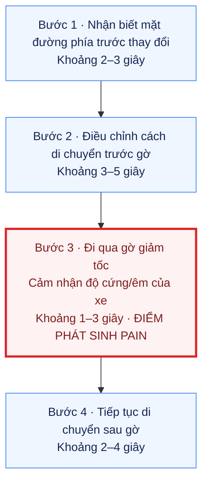
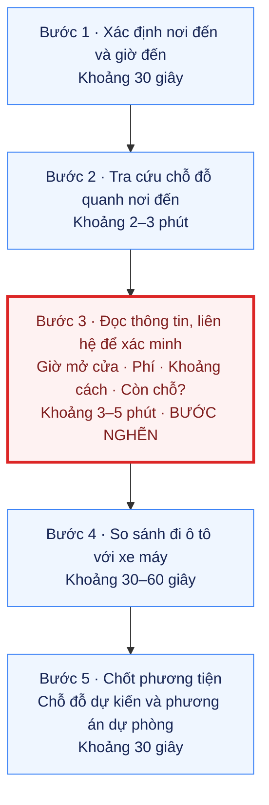
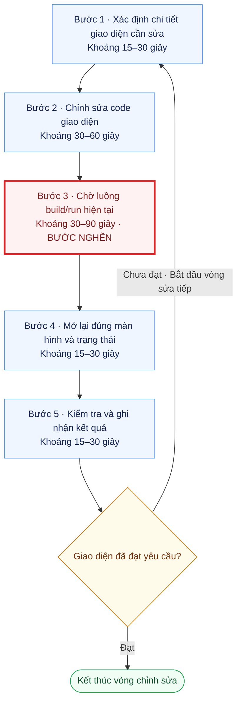

# Báo cáo cá nhân — 2A202603501 — Nguyễn Phú Nam

## 1. Thông tin cá nhân

- Họ tên: Nguyễn Phú Nam
- MSSV: 2A202603501
- Tên nhóm: BunRieuTopMo
- Link repo nhóm: https://github.com/TgTrh06/K5-L3A-DAY02-BunRieuTopMo-DiscoveryProblemFraming.git

---

## 2. Scan problem (CP1)

Lăng kính: **Lặp lại** · **Tốn thời gian** · **Cần đọc, tổng hợp nhiều thông tin** · **Pain từ người khác**.

| # | Lăng kính | Job Story: Khi… tôi muốn… để… | Ai chịu ảnh hưởng? | Dấu hiệu thật (thời gian, tần suất, số người, bằng chứng) |
|---:|---|---|---|---|
| 1 | Pain từ người khác | Khi lái xe qua những đoạn đường có điều kiện mặt đường khác nhau, tôi muốn duy trì cảm giác êm ái và độ ổn định phù hợp, để di chuyển thoải mái và kiểm soát xe tốt hơn. | Những người lái xe. | Những xe tối ưu cho đường cao tốc, ổn định ở tốc độ cao có thể cho cảm giác rất cứng khi qua gờ giảm tốc, ổ voi, ổ gà; ngược lại, những xe tối ưu cho địa hình gồ ghề có thể cho cảm giác bồng bềnh khi chạy cao tốc. Đây là mô tả pain ban đầu, chưa phải kết luận kỹ thuật cho mọi xe. Có thể kiểm chứng bằng nhật ký cùng tuyến đường, loại xe và điểm khó chịu do người lái tự đánh giá; chưa có dữ liệu đo hoặc lời kể trực tiếp của người lái khác. |
| 2 | Cần đọc, tổng hợp nhiều thông tin | Khi ôn tập từ một xấp giấy hoặc vở ghi viết tay, tôi muốn hệ thống lại kiến thức theo chủ đề và mối liên hệ giữa các phần, để dễ tìm lại nội dung và ôn tập có trình tự. | Sinh viên, học sinh sử dụng ghi chép viết tay. | Tôi đang có một xấp giấy/vở ghi viết tay cần tổng hợp, hệ thống lại kiến thức. Đây là hiện vật ban đầu cho việc thông tin đang nằm trong ghi chép, chưa có số trang hoặc thời gian tổng hợp được đo. Cách lượng hóa: đếm số trang của một môn, bấm giờ tìm một nội dung và tổng hợp một chủ đề; ghi lại những phần trùng hoặc thiếu liên kết nếu quan sát thấy. |
| 3 | Pain từ người khác | Khi chuẩn bị đến một địa điểm và cân nhắc đi xe máy hay ô tô, tôi muốn biết có chỗ đỗ ô tô phù hợp gần nơi đến hay không, để chọn phương tiện trước khi xuất phát và hạn chế mất thời gian tìm chỗ đỗ khi tới nơi. | Những người sở hữu cả ô tô và xe máy ở những thành phố lớn. | Tôi luôn phải cân nhắc chọn xe máy hay ô tô vì lo không có chỗ đỗ ô tô gần nơi muốn tới. Dấu hiệu ban đầu là sự phân vân lặp lại trước chuyến đi do thiếu thông tin chỗ đỗ; chưa xác nhận đã mất bao lâu hoặc từng không tìm được chỗ. Để kiểm chứng pain của actor rộng hơn, ghi lại quyết định trong các chuyến đi thực tế và hỏi người sở hữu cả hai phương tiện về lần gần nhất gặp tình huống này. |
| 4 | Lặp lại · Tốn thời gian | Khi chỉnh sửa một chi tiết giao diện nhỏ trong dự án Flutter, tôi muốn kiểm tra nhanh kết quả thay đổi trên màn hình cần xem, để tiếp tục tinh chỉnh mà không phải chờ lâu giữa các lần sửa. | Các frontend developer; phạm vi khảo sát ban đầu là frontend developer dùng Flutter. | Mỗi lần chỉnh sửa frontend Flutter, dù chỉ chi tiết nhỏ, tôi vẫn phải chạy lại luồng compile để test. Dấu hiệu là công đoạn chạy lại lặp theo từng vòng sửa–kiểm tra; chưa đo thời gian chờ hoặc số vòng trong buổi. Cách lượng hóa: ghi màn hình và log của các vòng sửa, tách thời gian build/reload, mở lại màn hình và kiểm tra. Flutter có hot reload nên cần xác định loại thay đổi và cấu hình khiến quy trình hiện tại phải chạy lại, không coi đây là hạn chế mặc định của Flutter. |
| 5 | Cần đọc, tổng hợp nhiều thông tin · Lặp lại | Khi quay lại làm bài nhóm sau nhiều tin nhắn trao đổi, tôi muốn tìm được deadline, phân công và yêu cầu mới nhất của phần mình phụ trách, để thực hiện đúng việc và đúng hạn. | Sinh viên làm bài nhóm, nhận thông tin qua các tin nhắn trao đổi. | Giả thuyết cần kiểm chứng: deadline, phân công và các lần thay đổi yêu cầu nằm xen trong hội thoại khiến thành viên phải đọc lại tin nhắn để biết việc cần làm. Tôi chưa ghi lại lần xảy ra cụ thể, thời gian tìm hoặc số lần phải hỏi lại. Dấu hiệu cần thu thập từ nhóm thật: tin nhắn cập nhật công việc đã che tên, thời gian tìm lại phiên bản yêu cầu mới nhất và số lần hỏi lại cùng một thông tin. |

### Ghi chú về cách xác định vấn đề

- Dòng 1 được chuyển từ giải pháp “phuộc tự điều chỉnh độ mềm/cứng” sang nhu cầu của người lái. Cơ chế điều chỉnh phuộc là một phương án có thể xem xét sau, chưa chốt tại CP1.
- Tôi mở rộng actor ở cả 5 dòng và chọn lăng kính pain từ người khác cho dòng 1, 3. Những quan sát ban đầu của tôi vẫn cần được kiểm chứng với người ngoài nhóm ở CP4.
- Mỗi dòng đã có mô tả dấu hiệu hoặc kế hoạch thu thập cụ thể; để đạt yêu cầu dấu hiệu thật đo được của CP1, cần bổ sung số liệu thực tế. Đặc biệt, dòng 5 hiện mới có giả thuyết.

**Nếu có dùng AI để gợi ý thêm:** ý nào AI gợi ý mà bạn giữ lại, ý nào bỏ và vì sao.

- Tôi tự nêu 4 vấn đề về trải nghiệm lái xe, ghi chép viết tay, chỗ đỗ ô tô và kiểm tra giao diện Flutter.
- Tôi nhờ AI hỗ trợ diễn đạt theo Job Story, xác định actor, gợi ý lăng kính và dữ liệu cần thu thập. AI đề xuất thêm vấn đề theo dõi deadline/phân công trong tin nhắn nhóm ở dòng 5.
- Tôi giữ vấn đề 5 trong danh sách scan và chọn actor theo gợi ý, nhưng chưa có bằng chứng hành vi thực tế.
- Tôi mở rộng actor từ bản thân sang các nhóm người bị ảnh hưởng, chuyển dòng 1 và 3 sang pain từ người khác, đồng thời bổ sung mô tả cảm giác cứng/bồng bềnh ở dòng 1. Tôi chưa loại vấn đề nào khỏi danh sách.

---

## 3. Top 3 Problem Cards + quy trình nháp (CP2)

> Tôi chọn 3 vấn đề số 1, 3, 4 trong bảng CP1. Card #1 ứng với vấn đề 1, card #2 ứng với vấn đề 3, card #3 ứng với vấn đề 4. Các quy trình là bản nháp giả định để kiểm chứng, không phải quy trình đã quan sát từ người được phỏng vấn. Tôi dùng khoảng thời gian ước lượng theo từng tình huống, chưa bấm giờ thực tế. Target là mục tiêu tôi đang cân nhắc, chưa phải kết quả đạt được.

### Bảng chọn top 3

| Rank | Problem | Vì sao chọn | Điều còn chưa chắc |
|---:|---|---|---|
| 1 | Vấn đề 3 — Thiếu thông tin chỗ đỗ ô tô khi lựa chọn phương tiện | Actor và thời điểm ra quyết định rõ; có thể vẽ quy trình tra cứu–xác nhận–chọn xe, đo thời gian và hỏi người dùng thật; là vấn đề tôi muốn pitch nhất. | Người dùng thật sự thiếu vị trí bãi, thông tin còn chỗ hay thông tin giờ/phí? Dữ liệu có đủ mới để hỗ trợ quyết định không? |
| 2 | Vấn đề 4 — Mất thời gian kiểm tra thay đổi frontend Flutter | Có thể quan sát trực tiếp bằng log và ghi màn hình; bước chờ dễ tách khỏi thời gian chỉnh giao diện; có phương án dùng công cụ sẵn có. | Phải full restart vì thay đổi nào? Hot reload đã được dùng đúng chưa? Bước nghẽn là build hay đi lại luồng để tới màn hình cần xem? |
| 3 | Vấn đề 1 — Trải nghiệm xe không phù hợp khi đổi điều kiện mặt đường | Pain được mô tả cụ thể theo hai tình huống trái ngược; có thể kiểm tra bằng phản hồi người lái và so sánh các đoạn đường trên cùng tuyến. | Ảnh hưởng của loại xe, thiết lập hệ thống treo, lốp và tốc độ chưa được tách; phạm vi liên quan phần cứng có thể vượt khả năng thử nghiệm trong một buổi lab. |

### Problem Card #1 — Trải nghiệm lái xe khi thay đổi điều kiện mặt đường (vấn đề 1)

| Trường | Nội dung |
|---|---|
| Job Story | Khi lái xe qua những đoạn đường có điều kiện mặt đường khác nhau, tôi muốn duy trì cảm giác êm ái và độ ổn định phù hợp, để di chuyển thoải mái và kiểm soát xe tốt hơn. |
| Actor | Những người lái xe; phạm vi kiểm chứng ban đầu đề xuất là người lái ô tô đi qua cả đoạn đường bằng phẳng và đoạn có gờ/ổ gà trong cùng chuyến. |
| Thời điểm / bối cảnh | Xe đi từ mặt đường bằng phẳng sang đoạn gồ ghề hoặc ngược lại; người lái nhận thấy cảm giác quá cứng hoặc bồng bềnh theo quan sát ban đầu. |
| Quy trình hiện tại (3–7 bước) | Ví dụ một lần gặp gờ giảm tốc: 1. Nhận biết mặt đường phía trước thay đổi → 2. Điều chỉnh cách di chuyển trước gờ → 3. Đi qua gờ và cảm nhận độ cứng/êm của xe → 4. Tiếp tục di chuyển sau gờ. Việc ghi nhật ký đánh giá thực hiện sau chuyến đi, tách khỏi sự kiện này. |
| Bottleneck (bước nào, mất bao nhiêu phút) | Bước 3: cảm giác khó chịu xuất hiện khi xe đi qua gờ; khoảng quan sát minh họa 1–3 giây/lần. Đây là điểm phát sinh pain cần kiểm chứng, không phải bước chờ có thể cắt bớt để đi nhanh hơn, cũng không phải số đo thời gian phản ứng của hệ thống treo. |
| Impact (nếu không giải thì sao) | Có thể gây khó chịu, giảm tự tin khi điều khiển và buộc người lái thích nghi theo từng đoạn đường; chưa có bằng chứng để quy thành số vụ mất an toàn hay thiệt hại tiền bạc. |
| Success metric (baseline → target) | Baseline: chưa đo điểm khó chịu; đề xuất người lái chấm 1–5 sau mỗi đoạn (1 = không khó chịu, 5 = rất khó chịu) trên tuyến đã chọn. Target: giảm ít nhất 1 điểm trung bình trên cùng nhóm đoạn đường so với baseline, không làm tăng điểm khó chịu ở nhóm đoạn còn lại. Đo lặp lại cùng xe và ghi điều kiện chuyến đi; không dùng số phút lái xe làm thước đo độ êm. |
| Phương án không dùng AI | Đánh giá tình trạng và thiết lập xe với người có chuyên môn; sử dụng đúng chế độ sẵn có nếu xe hỗ trợ, chọn tuyến phù hợp và điều chỉnh cách lái. Cần kiểm tra các cách này đã đủ giải quyết pain chưa. |
| Giả thuyết về AI (nếu có) | Có thể hỗ trợ phân tích phản hồi sau chuyến đi để tìm tình huống gây khó chịu. Chưa có cơ sở cần AI điều khiển phuộc; dữ liệu cảm biến, khả năng tác động phần cứng và cách đánh giá chưa được xác minh. |
| Cảm nhận nhanh | Chưa biết; ưu tiên kiểm tra phương án No AI/Rule trước. |

Quy trình nháp hiện tại — một lần gặp gờ giảm tốc, khoảng 8–15 giây:

Tôi dùng một tình huống chuyển mặt đường ngắn để minh họa, thay vì gán vài phút cho từng thao tác lái xe. Các mốc dưới đây là khoảng quan sát giả định, không dùng làm hướng dẫn tốc độ hay thời điểm thao tác. Nếu đi trên đoạn gồ ghề kéo dài, thời lượng cần ghi theo tuyến thực tế. Sau chuyến đi, tôi dành riêng khoảng 30–60 giây để ghi đánh giá; thời gian này không cộng vào sự kiện đi qua gờ.

### Problem Card #2 — Chọn phương tiện khi chưa rõ chỗ đỗ ô tô (vấn đề 3)

| Trường | Nội dung |
|---|---|
| Job Story | Khi chuẩn bị đến một địa điểm và cân nhắc đi xe máy hay ô tô, tôi muốn biết có chỗ đỗ ô tô phù hợp gần nơi đến hay không, để chọn phương tiện trước khi xuất phát và hạn chế mất thời gian tìm chỗ đỗ khi tới nơi. |
| Actor | Những người sở hữu cả ô tô và xe máy ở những thành phố lớn; phạm vi ban đầu đề xuất là các chuyến đi đến địa điểm chưa quen. |
| Thời điểm / bối cảnh | Trước khi xuất phát, người đi chưa rõ nơi đến có chỗ đỗ ô tô hoặc bãi đỗ gần đó có đáp ứng thời gian, chi phí và khoảng cách đi bộ chấp nhận được không. |
| Quy trình hiện tại (3–7 bước) | 1. Xác định nơi đến và giờ đến → 2. Tra cứu chỗ đỗ gần đó → 3. Xác minh thông tin bằng nguồn hiện có hoặc liên hệ nơi đến/bãi đỗ → 4. So sánh việc đi ô tô và xe máy → 5. Chọn phương tiện, chỗ đỗ dự kiến và phương án dự phòng. |
| Bottleneck (bước nào, mất bao nhiêu phút) | Bước 3: đọc thông tin gần đây hoặc liên hệ nơi đến/bãi đỗ để xác minh điều kiện đỗ xe; ước lượng 3–5 phút/lần trong tình huống liên hệ được 1–2 nơi. Nếu không có phản hồi, thời gian chờ cần ghi riêng. Biết vị trí bãi không đồng nghĩa biết chắc còn chỗ. |
| Impact (nếu không giải thì sao) | Tiếp tục phân vân trước chuyến đi; có nguy cơ phải đổi phương tiện, đổi chỗ đỗ hoặc dành thêm thời gian tìm khi đến nơi. Đây là hệ quả cần kiểm chứng, chưa ghi nhận số lần xảy ra. |
| Success metric (baseline → target) | Baseline nháp: khoảng 6,5–10 phút từ lúc bắt đầu tìm thông tin đến khi chốt phương tiện trong tình huống tra cứu và liên hệ được nơi đến/bãi đỗ; cần thay bằng thời gian đo thực tế. Target đề xuất: không quá 5 phút, đồng thời không tăng tỷ lệ chuyến ô tô phải đổi chỗ đỗ do thông tin sai. Cách đo: ghi mốc bắt đầu–chốt xe và đối chiếu chỗ đỗ thực tế trong 5 chuyến trước, 5 chuyến sau khi thử cách hỗ trợ; ghi riêng trường hợp không liên hệ được hoặc không xác minh được thông tin. |
| Phương án không dùng AI | Checklist hỏi nơi đến về chỗ đỗ; danh sách bãi đỗ đã xác minh kèm giờ, phí, khoảng cách và thời điểm cập nhật; sử dụng bản đồ, liên hệ trực tiếp và chuẩn bị bãi dự phòng. |
| Giả thuyết về AI (nếu có) | Workflow có thể hỗ trợ tổng hợp thông tin từ những nguồn xác minh được và so sánh các lựa chọn theo nhu cầu chuyến đi. AI không tạo ra dữ liệu chỗ trống thời gian thực nếu nguồn không có; không được khẳng định chắc chắn còn chỗ từ thông tin cũ. |
| Cảm nhận nhanh | No AI hoặc Rule để bắt đầu; chỉ cân nhắc Workflow khi tổng hợp thông tin vẫn là bước nghẽn sau khi đã có dữ liệu phù hợp. |

Quy trình nháp hiện tại — khoảng 6,5–10 phút/lần, ước lượng:

Tình huống minh họa: tôi đã biết nơi muốn đến, tra cứu chỗ đỗ gần đó và liên hệ được 1–2 nơi để hỏi thêm. Tổng dưới đây chưa tính thời gian di chuyển, đi bộ từ bãi hoặc chờ phản hồi kéo dài.

### Problem Card #3 — Chờ kiểm tra thay đổi frontend Flutter (vấn đề 4)

| Trường | Nội dung |
|---|---|
| Job Story | Khi chỉnh sửa một chi tiết giao diện nhỏ trong dự án Flutter, tôi muốn kiểm tra nhanh kết quả thay đổi trên màn hình cần xem, để tiếp tục tinh chỉnh mà không phải chờ lâu giữa các lần sửa. |
| Actor | Các frontend developer; phạm vi ban đầu là người làm frontend Flutter trong dự án đang có quy trình chạy lại sau mỗi lần sửa. |
| Thời điểm / bối cảnh | Trong vòng lặp chỉnh giao diện–chạy lại–mở màn hình–kiểm tra; cần phân biệt thay đổi Dart/widget với thay đổi thực sự cần full restart. |
| Quy trình hiện tại (3–7 bước) | 1. Xác định chi tiết cần sửa → 2. Sửa code giao diện → 3. Chạy lại luồng build/run hiện tại → 4. Đưa ứng dụng đến đúng màn hình/trạng thái cần xem → 5. Kiểm tra kết quả và quyết định vòng sửa tiếp theo. |
| Bottleneck (bước nào, mất bao nhiêu phút) | Bước 3: chờ luồng build/run lại ứng dụng, ước lượng 30–90 giây/vòng trong môi trường đã thiết lập, không tính clean build hoặc tải dependencies. Bước 4 mất thêm khoảng 15–30 giây nếu chỉ cần vài thao tác để mở màn hình; luồng đăng nhập hoặc dựng dữ liệu phức tạp phải đo riêng. |
| Impact (nếu không giải thì sao) | Thời gian chờ lặp lại theo số vòng sửa, làm gián đoạn việc tinh chỉnh. Với giả định 10 vòng, tổng chờ build/run khoảng 5–15 phút; nếu tính cả việc mở lại màn hình thì khoảng 7,5–20 phút. Đây là phép tính từ các khoảng ước lượng, chưa phải thống kê một buổi làm việc thật. |
| Success metric (baseline → target) | Baseline nháp: khoảng 45–120 giây từ khi lưu thay đổi đến khi sẵn sàng quan sát đúng màn hình (30–90 giây build/run + 15–30 giây mở lại màn hình), chưa đo thực tế. Target đề xuất: không quá 30 giây cho thay đổi giao diện đủ điều kiện hot reload, vẫn thấy đúng trạng thái cần kiểm tra. Cách đo: ghi log/ghi màn hình tối thiểu 10 vòng thay đổi tương đương; so sánh trung vị trước/sau và ghi riêng các trường hợp cần restart. |
| Phương án không dùng AI | Kiểm tra cấu hình debug và dùng hot reload khi phù hợp; dùng hot restart/full restart khi loại thay đổi yêu cầu; tạo dữ liệu mẫu và lối mở trực tiếp tới màn hình cần kiểm tra. Không thay việc kiểm tra thay đổi native bằng hot reload. |
| Giả thuyết về AI (nếu có) | Có thể hỗ trợ đọc log hoặc phân loại nguyên nhân chạy lại; chưa có cơ sở cho rằng AI giảm được thời gian compile. Trước hết kiểm tra công cụ phát triển và cách thiết lập môi trường hiện có. |
| Cảm nhận nhanh | No AI / Rule; chưa có lý do chọn Workflow hay Agent. |

Quy trình nháp hiện tại — khoảng 1 phút 45 giây đến 4 phút/vòng, ước lượng:

Tình huống minh họa là sửa một chi tiết nhỏ như màu, khoảng cách hoặc cỡ chữ nhưng vẫn chạy lại ứng dụng theo cách hiện tại; môi trường và dependencies đã sẵn sàng. Khoảng build/run phụ thuộc máy, thiết bị và dự án, không phải thời gian mặc định của Flutter. Nhánh quyết định ở cuối nằm trong thời gian kiểm tra của bước 5; mỗi lần quay lại bắt đầu một vòng mới.

Lưu ý kỹ thuật: Flutter hỗ trợ hot reload để cập nhật code và giữ trạng thái ứng dụng trong các trường hợp phù hợp; hot restart và full restart có hành vi khác. Vì vậy, pain ở đây thuộc quy trình/dự án cụ thể, chưa phải khẳng định mọi sửa đổi Flutter đều bắt buộc compile lại toàn bộ. Nguồn: [Flutter — Hot reload](https://docs.flutter.dev/tools/hot-reload).

### Card muốn pitch nhất

- Card số: **#2 — Vấn đề 3: Chọn phương tiện khi chưa rõ chỗ đỗ ô tô.**
- Vì sao: tôi ưu tiên pitch vấn đề này vì thời điểm phát sinh rõ, có thể tiếp cận actor để hỏi về chuyện đã xảy ra và có thể đo thời gian trong quy trình. Tôi cũng có thể so sánh các cách giải đơn giản trước khi cân nhắc AI.
- Câu hỏi muốn nhóm phản biện: “Pain chính là không biết vị trí bãi đỗ, không biết chắc còn chỗ hay không tìm được thông tin phù hợp về giờ/phí/khoảng cách? Nếu chỉ dùng bản đồ, checklist và gọi xác nhận thì đã đủ chưa?”

### AI đã phản biện card thế nào

| Điểm yếu AI chỉ ra | Đồng ý? | Đã sửa gì |
|---|---|---|
| Card #1: actor “người lái xe” còn rộng; cảm giác cứng/bồng bềnh có thể liên quan nhiều yếu tố, chưa đủ cơ sở quy hết cho phuộc. Quy trình nhận ra khó chịu cũng có thể mới là biểu hiện chứ chưa xác định được nguyên nhân. | Tôi chưa chốt đánh giá. | Bản nháp thu hẹp phạm vi quan sát ban đầu, phân biệt thời lượng đoạn đường với thời gian phản ứng của phuộc; chuyển metric sang điểm khó chịu và chưa chọn AI điều khiển phần cứng. |
| Card #2: dữ liệu vị trí bãi đỗ không chứng minh còn chỗ tại giờ đến; phạm vi thành phố lớn vẫn rộng và nguồn cập nhật có thể là rào cản chính. | Tôi chưa chốt đánh giá. | Bản nháp chọn bối cảnh điểm đến chưa quen, tách bước tra cứu khỏi xác minh; thêm kiểm tra tỷ lệ phải đổi chỗ đỗ và giới hạn không khẳng định còn chỗ khi thiếu dữ liệu. |
| Card #3: Flutter có hot reload; chưa phân biệt build chậm với mất thời gian tái tạo trạng thái màn hình. AI có thể không cần thiết. | Tôi chưa chốt đánh giá. | Bản nháp tách bước build/run và mở lại màn hình, chỉ áp target hot reload cho thay đổi phù hợp; ưu tiên cách xử lý No AI/Rule. |

Tôi dùng AI để phản biện các card ở CP2. Cột “Đã sửa gì” ghi những thay đổi trong bản nháp do AI hỗ trợ; tôi vẫn cần tự đánh giá và xác nhận các thay đổi trước khi chốt card.

---

## 4. Tôi đã tham gia phần nào (CP3 → CP7)

### 4.1. Bối cảnh chung dùng để đồng bộ

| Nội dung | Thống nhất trong kịch bản luyện tập |
|---|---|
| Candidate nhóm chọn | Tôi và các bạn trong khóa cần gom và xác nhận deadline lab từ LMS, repo đề, Discord lớp và Zalo nhóm để tránh nhầm hạn hoặc bỏ sót gia hạn. |
| Actor | Người học AI20k vừa học vừa làm, theo nhiều lab trong tuần. |
| Quy trình hiện tại | Mở LMS → đọc hạn trong repo và quy đổi theo buổi học → tìm thông báo gia hạn trên Discord → xem mốc nội bộ trên Zalo → ghi note → đặt nhắc. |
| Bottleneck | Đọc và quy đổi hạn, sau đó dò gia hạn; tổng ước tính 12 trong khoảng 20 phút/tuần. |
| Metric | Thời gian gom hạn từ khoảng 20 xuống dưới 5 phút/tuần; số lần suýt trễ/nhầm hạn từ 2/tháng về 0. Các baseline này là giả định của bài luyện tập, cần đo lại. |
| Mức can thiệp | Rule: dùng lịch chung, quy tắc xác định hạn và nhắc việc cố định; con người xác minh, cập nhật ngoại lệ. Không dùng AI ở bước chính. |
| Boundary | Nguồn chuẩn là LMS và thông báo chính thức của coach; lịch chung để tham chiếu. Không tự suy đoán hoặc sửa deadline khi thiếu thông báo xác nhận. |
| Quyết định | Go phạm vi nhỏ, thử trong nhóm trong 3 tuần. |
| Ngưỡng xem xét lại | Sau 3 tuần vẫn có người nhầm hạn hoặc người cập nhật bỏ sót gia hạn quá 1 lần thì rà lại quy trình và bổ sung bước nhắc/xác nhận. Đây chưa phải lý do tự động nâng lên AI. |

### 4.2. Vai trò và đóng góp trong mô phỏng

| Hoạt động | Tôi đã làm gì trong mô phỏng? | Kết quả / ảnh hưởng tới bài nhóm trong mô phỏng |
|---|---|---|
| Pitch Problem Card | Trình bày 3 vấn đề: trải nghiệm xe khi đổi mặt đường, chọn phương tiện khi chưa rõ chỗ đỗ và chờ kiểm tra frontend Flutter; ưu tiên vấn đề chỗ đỗ xe. | Mang vào thảo luận các candidate khác với nhóm  |
| Phản biện bài của bạn khác | Câu hỏi mô phỏng cho card gom deadline của Hoàng: “Nếu thông báo gia hạn khác lịch đã nhập, ai chịu trách nhiệm xác nhận và sửa? Nhập lịch một lần có đồng nghĩa lịch luôn cập nhật không?” | Bổ sung người phụ trách cập nhật và bước đối chiếu nguồn chính thức; không đồng nhất nhập lịch với đồng bộ liên tục. |
| Nhận phản biện | Câu hỏi mô phỏng cho card chỗ đỗ: “Biết có bãi đỗ gần nơi đến đã đủ để quyết định đi ô tô chưa, nếu không biết còn chỗ vào giờ đến?” | Tách tra cứu vị trí khỏi xác minh tình trạng và điều kiện sử dụng; xem tính cập nhật của dữ liệu là giả định quan trọng. |
| Gom cluster / cây OST | Đối chiếu vấn đề 5 của tôi với các card gom deadline, đọc đề và bắt kịp chat của Hoàng. | Có thể gom thành cluster “tìm và xác nhận thông tin để tiếp tục công việc”; outcome luyện tập thu hẹp vào giảm thời gian xác nhận hạn lab. Không đưa “bot nhắc hạn” vào tầng opportunity. |
| Chọn candidate problem | So sánh khả năng tiếp cận người dùng, quan sát quy trình, đo tác động và có dữ liệu. | Chấp nhận hướng gom deadline trong mô phỏng vì vừa phạm vi lab; không biến việc tôi thích card chỗ đỗ thành lý do bắt buộc nhóm chọn card đó. |
| Kiểm chứng / research | Đối chiếu quy định hạn trong repo và tài liệu chính thức về nhập lịch. Dữ liệu phỏng vấn trong báo cáo Hoàng được xem là tình huống tham chiếu của bài luyện tập. | Tách được nguồn quy định, khả năng công cụ và giả định về hành vi; không tự thêm người được hỏi, câu trích dẫn hoặc số người khảo sát. |
| Quy trình nhóm | Rà điểm bàn giao giữa đọc nguồn, xác nhận ngoại lệ và cập nhật lịch; yêu cầu tách hạn LMS khỏi mốc nội bộ. | Quy trình tương lai có bước con người kiểm tra trước khi công bố mốc chung và cách quay về xem nguồn gốc nếu lịch chưa đáng tin. |
| Problem Statement | Rà baseline, target, đơn vị và cách đo; phân biệt thời gian gom hạn, nhầm hạn và trễ thật. | Giữ mục tiêu 20 → dưới 5 phút/tuần và 2 lần nhầm/tháng → 0 dưới dạng giả định; pilot 3 tuần đo thời gian hằng tuần và ghi sự cố, chưa đủ để khẳng định kết quả dài hạn. |
| Mức can thiệp AI | Kiểm tra liệu quy tắc hạn rõ ràng và thao tác lịch sẵn có đã đáp ứng nhu cầu chưa; chỉ ra rằng văn bản thông báo không tự động tạo nhu cầu dùng AI. | Giữ mức Rule; trường AI intervention point ghi “Không có”. Không cần tự xây Agent để gom vài nguồn và xử lý ngoại lệ do người xác nhận. |
| Quyết định | Đề xuất theo dõi lỗi cập nhật cùng hiệu quả tiết kiệm thời gian, thay vì chỉ xem lịch đã tạo được hay chưa. | Giữ Go trong nhóm, 3 tuần; dùng ngưỡng nhầm hạn/bỏ sót gia hạn của kịch bản chung để quyết định sửa hoặc mở rộng thử nghiệm. |

### 4.3. Vì sao các card cá nhân chưa trở thành candidate nhóm trong mô phỏng?

| Card cá nhân | Lý do tạm không ưu tiên so với candidate gom deadline |
|---|---|
| #1 — Trải nghiệm xe | Cần tách nhiều yếu tố kỹ thuật và có điều kiện quan sát phù hợp; thử nghiệm phần cứng vượt phạm vi một buổi lab. |
| #2 — Chỗ đỗ ô tô | Vẫn là card tôi muốn pitch nhất, nhưng giá trị phụ thuộc khả năng xác minh thông tin đúng thời điểm; chưa có nguồn dữ liệu hay người dùng được kiểm chứng. |
| #3 — Kiểm tra frontend Flutter | Có thể dùng công cụ và cấu hình hiện có để cải thiện trước; chưa xác nhận nguyên nhân chạy lại hoặc mức phổ biến ngoài dự án của tôi. |

Việc tạm chọn candidate khác không chứng minh ba vấn đề trên không có giá trị. Trong mô phỏng, đây là quyết định về phạm vi kiểm chứng và mức sẵn sàng của dữ liệu.

---

## 5. Dùng AI

Bảng này ghi việc AI hỗ trợ soạn báo cáo và phân tích tài liệu trong cuộc trao đổi. Các nhận định về CP4–CP6 là hỗ trợ cho kịch bản luyện tập, không phải bằng chứng tôi đã thực hiện phỏng vấn hoặc đã hoàn tất phần nhóm.

| Checkpoint | Tôi dùng AI để làm gì? | AI hữu ích ở đâu? | AI sai hoặc hời hợt ở đâu? | Tôi sửa gì bằng nhận định của mình? |
|---|---|---|---|---|
| CP1 Scan | Chuẩn hóa 4 vấn đề tôi tự nêu, gợi ý vấn đề thứ 5 và cập nhật theo phản hồi. | Viết theo Job Story, tách nhu cầu khỏi giải pháp và gợi ý cách thu thập dấu hiệu. | Bản đầu thu hẹp actor về bản thân, chưa thể hiện rõ pain từ người khác; thiếu số liệu thực tế. | Tôi yêu cầu mở rộng actor cho cả 5 dòng, đổi lăng kính dòng 1 và 3, bổ sung quan sát về cảm giác xe cứng/bồng bềnh. |
| CP2 Problem Card | Dựng bản nháp 3 card cho vấn đề 1, 3, 4 và phản biện từng card. | Tách bước tra cứu khỏi xác minh chỗ đỗ; phân biệt build/run với mở lại màn hình Flutter; đề xuất metric. | Các số phút là giả định; quy trình card xe chưa được quan sát; bản nháp không tự chứng minh nguyên nhân kỹ thuật. | Tôi chốt 3 candidate và ưu tiên pitch vấn đề 3. Các số phút vẫn ghi rõ là ước lượng, không chuyển thành kết quả đo. |
| CP4 Research | Đối chiếu hướng lịch chung trong báo cáo Hoàng với tài liệu Google Calendar và Moodle. | Xác nhận khả năng nhập ICS/CSV, đồng thời nhận ra nhập file không bảo đảm tự cập nhật; phân biệt tính năng nền tảng với triển khai của lớp. | Tài liệu công cụ không chứng minh LMS lớp đã bật xuất lịch hay toàn bộ hạn đều chính xác. | Trong bản luyện tập, giới hạn claim ở khả năng được tài liệu hỗ trợ; giữ bước người kiểm tra thông báo chính thức. Chưa xác nhận tính năng trên LMS của lớp. |
| CP5 Quy trình | Rà các bước và điểm con người cần xác nhận trong quy trình của kịch bản chung. | Làm rõ bàn giao từ nguồn chính thức tới lịch chung, hạn nội bộ và phương án đối chiếu khi có sai lệch. | Sơ đồ hợp lý trên giấy không chứng minh ai thực sự cập nhật hay cập nhật mất bao lâu. | Bản nháp giữ người xác nhận ngoại lệ và kế hoạch đo; chưa ghi tên người phụ trách thật khi TEAM.md chưa phân công. |
| CP5–6 Problem Statement | Rà chuỗi actor → bottleneck → metric → boundary để ăn khớp báo cáo tham chiếu. | Phân biệt baseline ước tính với target; tách số lần nhầm hạn khỏi việc trễ nộp thật. | Pilot 3 tuần chưa đủ xác nhận bền vững mục tiêu tính theo tháng; các số liệu từ bài Hoàng cũng là minh họa. | Bản luyện tập dùng thời gian mỗi tuần và nhật ký sự cố để theo dõi sớm; không ghi target thành thành tích đã đạt. |
| CP6 Mức can thiệp / quyết định | So sánh mức can thiệp và rà Go, pilot, ngưỡng xem xét lại trong kịch bản chung. | Chỉ ra rằng thiếu trách nhiệm cập nhật hoặc dữ liệu mới có thể là vấn đề chính, dù có AI hay không. | Chưa có kết quả pilot để chứng minh Rule đã đủ hoặc tự đánh giá tất cả rủi ro là thấp. | Giữ Rule và Go phạm vi nhỏ theo kịch bản Hoàng; không khẳng định triển khai rộng hay tự đổi sang Agent. |

---

## 6. Reflection (CP7)

> **Reflection mẫu cho bài luyện tập nhập vai.** Nội dung dưới đây là phần mô phỏng được AI hỗ trợ viết theo yêu cầu; không được trình bày như nhật ký trải nghiệm cá nhân đã xác nhận. Khi dùng làm bài nộp chính thức, tôi cần tự viết phần reflection từ trải nghiệm thực tế theo quy định của lab.

**6.1. Tôi học được gì khi nghe top 3 problems của các bạn khác?**

Khi đối chiếu ba card của mình với ba card trong báo cáo Hoàng, tôi nhận ra một vấn đề không cần mới lạ hay liên quan kỹ thuật phức tạp mới đáng phân tích. Card chỗ đỗ xe của tôi có thời điểm phát sinh rõ nhưng phụ thuộc dữ liệu đúng lúc. Card gom deadline gần với hoạt động học hơn, dễ quan sát và có quy trình kiểm chứng nhỏ. Điểm chung là người dùng cần thông tin đủ tin cậy trước khi quyết định, nhưng nguồn dữ liệu và cách kiểm tra của hai bài khác nhau.

**6.2. Nhóm có lúc nào bị "solution-first" (nghĩ giải pháp trước khi hiểu vấn đề) không? Lúc đó nhóm nhận ra và xử lý thế nào?**

Trong ý tưởng ban đầu của tôi, “phuộc tự điều chỉnh” đã là một cơ chế giải quyết, trong khi nhu cầu thật là cảm giác êm và ổn định khi điều kiện mặt đường thay đổi. Tôi cần quay lại mô tả người lái gặp khó chịu ở tình huống nào trước khi chọn cơ chế. Với kịch bản gom deadline, tôi cũng cần tránh đưa “bot nhắc hạn” vào tầng opportunity. Cây OST phải giữ các nhánh như khó xác nhận hạn mới nhất hoặc khó phân biệt hạn chính thức với mốc nhóm.

**6.3. Tôi có đổi ý sau khi bị phản biện không? Kể một lần cụ thể.**

Tình huống tôi rút ra từ card chỗ đỗ là sự khác nhau giữa biết vị trí bãi và biết có thể sử dụng bãi vào giờ đến. Nếu chỉ liệt kê bãi gần địa điểm, đầu ra vẫn chưa giúp người dùng yên tâm chọn ô tô. Tôi điều chỉnh cách phân tích bằng việc tách bước tìm thông tin khỏi bước xác minh và thêm chỉ số chuyến phải đổi chỗ đỗ vì thông tin sai. Phản biện này nằm trong bản luyện tập; chưa có biên bản xác nhận một thành viên cụ thể đã hỏi tôi câu đó.

**6.4. Kết quả kiểm chứng (phỏng vấn/survey/research) có làm tôi bất ngờ không? Điều gì?**

Điều đáng chú ý khi đối chiếu tài liệu là nhập một file lịch không có nghĩa những thay đổi sau đó sẽ tự được đồng bộ. Vì vậy, nói “đã có lịch chung” chưa đủ giải quyết việc coach gia hạn. Bài vẫn cần người kiểm tra nguồn và cập nhật ngoại lệ. Tôi không có dữ liệu phỏng vấn trực tiếp để kết luận cả lớp đều gặp pain này; tín hiệu phản bác trong báo cáo Hoàng chỉ là nội dung tham chiếu của kịch bản luyện tập.

**6.5. Điều khó nhất khi viết Problem Statement là gì?**

Khó nhất là đặt metric đúng với nhu cầu và có cách đo phù hợp. Với bài xe, số phút đi qua một đoạn xấu không trực tiếp cho biết xe êm hơn. Với bài deadline, giảm thời gian tra cứu mà làm tăng nhầm hạn cũng chưa thành công. Tôi cần ghi rõ đâu là baseline chưa đo, đâu là target, ai ghi dữ liệu và ghi trong khoảng thời gian nào. Một con số trình bày cụ thể vẫn có thể chỉ là ước lượng.

**6.6. Nếu làm lại, tôi sẽ đổi gì? Tôi sẽ phản biện nhóm mạnh hơn ở điểm nào?**

Tôi sẽ thu thập một vài lần xảy ra thật trước khi hoàn thiện card, thay vì dành nhiều thời gian làm bản nháp có số phút minh họa. Tôi cũng sẽ hỏi sớm “nguồn nào là nguồn chuẩn, ai cập nhật khi thay đổi, và biết sai bằng cách nào”. Với card Flutter, tôi sẽ quay một vòng sửa–chạy–kiểm tra để tách thời gian build khỏi thời gian dựng lại trạng thái. Với bài nhóm, tôi sẽ xem Go là quyền thử nghiệm nhỏ có điều kiện, không coi đó là bằng chứng giải pháp đã hiệu quả.

**6.7. Hiểu bài:** giải thích bằng 5–8 câu chuỗi *problem → quy trình → metric → boundary → mức can thiệp AI → quyết định* của bài nhóm.

Theo kịch bản luyện tập chung, problem là tôi và các bạn trong khóa phải gom và xác nhận hạn lab từ nhiều kênh, tốn khoảng 20 phút mỗi tuần và có nguy cơ nhầm hạn. Quy trình hiện tại gồm xem LMS, đọc và quy đổi hạn trong repo, dò gia hạn trên Discord, xem mốc nhóm trên Zalo, ghi note và đặt nhắc; bước nghẽn là xác nhận đúng hạn sau các ngoại lệ. Metric đề xuất là giảm xuống dưới 5 phút mỗi tuần và đưa số lần suýt trễ hoặc nhầm hạn từ giả định 2 lần mỗi tháng về 0, theo dõi bằng bấm giờ và nhật ký sự cố. Boundary là chỉ sử dụng hạn đã được đối chiếu LMS hoặc thông báo coach, phân biệt lịch tham chiếu với nguồn chính thức và để con người xác nhận thay đổi. Mức chọn là Rule với quy tắc hạn và nhắc lịch cố định, không cần AI tự suy luận hay tự đổi deadline. Quyết định trong mô phỏng là Go cho nhóm thử 3 tuần, với người cập nhật được phân công rõ trước khi bắt đầu. Nếu vẫn có nhầm hạn hoặc bỏ sót gia hạn quá 1 lần thì rà lại trách nhiệm cập nhật và bước nhắc/xác nhận, rồi mới cân nhắc cách can thiệp khác.

---

## 7. Tài liệu tham khảo

- [Yêu cầu theo checkpoint](../../CHECKPOINTS.md), [quy định dùng AI](../../RULES.md), [rubric](../../RUBRIC.md) và [worksheet](../../docs/01-worksheet.md): yêu cầu bài lab.
- [SUBMISSION.md](../../SUBMISSION.md): quy tắc hạn nộp và cấu trúc bài.
- [Flutter — Hot reload](https://docs.flutter.dev/tools/hot-reload): đối chiếu khi phản biện card frontend Flutter.
- [Google Calendar — Import events](https://support.google.com/calendar/answer/37118): hỗ trợ nhập ICS/CSV; nhập file không bảo đảm các thay đổi sau đó tự đồng bộ.
- [Moodle — Calendar](https://docs.moodle.org/en/Calendar): tham khảo khả năng hiển thị sự kiện và hạn bài tập; không xác nhận cấu hình LMS của lớp.
